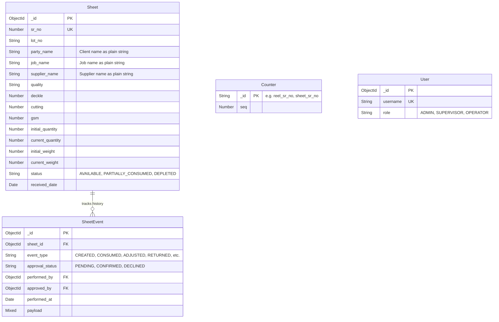
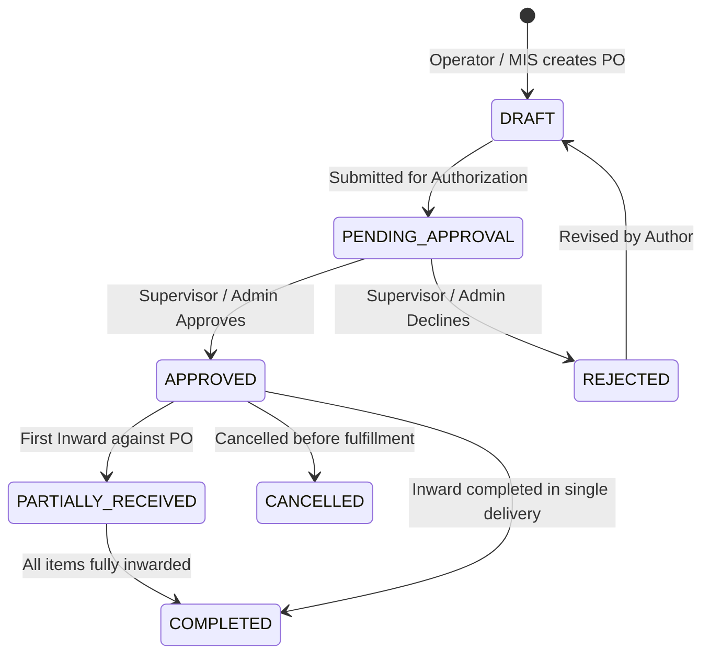
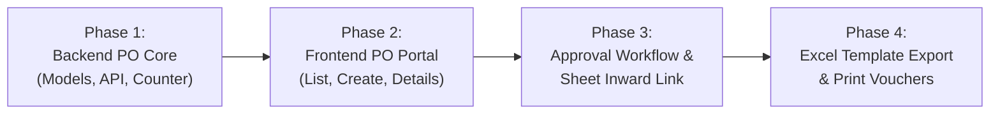

# Purchase Order (PO) Module: Current Status & Architecture Audit

**Document:** `PURCHASE_ORDER_CURRENT_STATUS_AUDIT.md`  
**System:** Rainbow Packaging Inventory Management System  
**Scope:** Sheet/Board Purchase Order Module Inspection  
**Audit Date:** November 4, 2026  
**Audit Type:** Strict Codebase & Template Inspection (Audit-Only / Non-Destructive)

---

## A. Executive Summary

A comprehensive architectural and codebase audit was conducted across the backend (Express.js 5 + Node.js 24 + MongoDB/Mongoose) and frontend (React 19 + Vite + Tailwind CSS) to determine whether any Purchase Order (PO) functionality currently exists in the Rainbow Packaging repository.

### Key Audit Findings:
1. **Purchase Order Implementation Level:** **0% Implemented (Not Implemented)**.  
   There are zero Purchase Order database models, controllers, services, API routes, validators, counter sequences, or frontend pages anywhere in the project. The terms `PurchaseOrder`, `purchase_order`, `purchaseOrder`, and `po_no` do not appear in any application source files or database schemas.
2. **Excel Template Availability:**  
   The template `BOARD_PO_FORMAT.xlsx` (11,667 bytes) is located in the project root. It defines a single worksheet (`Sheet1`, range `A1:J35`) containing header fields (PO No., PO Date, Delivery Date, Payment Terms), supplier details (Name, Contact Person, Phone/Email), a 20-row tabular item section (Sr No, Client Name, Job Name, Size CM, GSM, Qty, Weight), and signature blocks (Prepared By, Approved By). It contains no embedded Excel formulas.
3. **Surrounding Supporting Infrastructure:**  
   While the PO feature itself is completely absent, the application possesses robust foundational patterns that can be leveraged for its implementation:
   - **Sheet Domain & Math Engine:** [`backend/src/modules/sheets/utils/sheetCalculations.js`](file:///k:/GitHub/ecurve/rainbow-packaging/backend/src/modules/sheets/utils/sheetCalculations.js) contains exact packaging formulas for sheet area, single-sheet weight, and total weight (`calculateTotalWeight`).
   - **Atomic Sequence Generation:** [`backend/src/core/database/counter.service.js`](file:///k:/GitHub/ecurve/rainbow-packaging/backend/src/core/database/counter.service.js) provides an established MongoDB atomic sequence mechanism (`getNextSequence`) currently powering `reel_sr_no`, `sheet_sr_no`, and `finished_box_sr_no`.
   - **Audit & Approval Patterns:** Event-sourcing models ([`SheetEvent`](file:///k:/GitHub/ecurve/rainbow-packaging/backend/src/modules/sheets/models/sheetEvent.model.js), [`AuditLog`](file:///k:/GitHub/ecurve/rainbow-packaging/backend/src/modules/audit/models/auditLog.model.js)) and role guards (`ADMIN`, `SUPERVISOR`, `OPERATOR`) provide a tested template for PO approval workflows.
   - **Spreadsheet & Print Capabilities:** The frontend includes the `xlsx` (SheetJS) package for Excel export/import and browser print templates (`@media print` in `window.open`), though template-filling for `BOARD_PO_FORMAT.xlsx` has not yet been built.

---

## B. Excel Template Analysis (`BOARD_PO_FORMAT.xlsx`)

The file `BOARD_PO_FORMAT.xlsx` was inspected programmatically using SheetJS. The workbook characteristics are documented below:

### 1. File Metadata & Geometry
- **File Name:** `BOARD_PO_FORMAT.xlsx`
- **File Size:** 11,667 bytes
- **Author / Last Modified By:** `Rainbow IMS`
- **Application:** Microsoft Excel (v16.0300)
- **Worksheet Name:** `Sheet1` (Single worksheet)
- **Coordinate Grid:** Columns `A` to `J` (10 columns), Rows `1` to `35` (35 rows), Total range `A1:J35`.
- **Formulas:** **None** (all cells are static text, empty numeric placeholders, or empty strings).
- **Margins (Inches):** Top: 0.75", Bottom: 0.75", Left: 0.7", Right: 0.7", Header: 0.3", Footer: 0.3".

### 2. Header Structure & Metadata (Rows 1–6)
| Row | Coordinates | Merged Range | Display Text / Field Name | Purpose / Data Type |
|:---:|:---:|:---:|:---|:---|
| **1** | `A1:J1` | `A1:J1` | `RAINBOW PACKAGING INDUSTRY PVT. LTD.` | Company header title |
| **2** | `A2:J2` | `A2:J2` | `SIDCUL, HARIDWAR` | Company plant location |
| **3** | `A3:J3` | `A3:J3` | `PURCHASE ORDER` | Document document type header |
| **4** | `A4` | Single Cell | `PO No.:` | Label for Purchase Order Number |
| **4** | `D4:F4` | `D4:F4` | *(Empty)* | **Input Target:** PO Number (e.g. `PO-2026-0001`) |
| **4** | `G4` | Single Cell | `PO Date:` | Label for PO Issue Date |
| **4** | `H4:J4` | `H4:J4` | *(Empty)* | **Input Target:** PO Date (e.g. `2026-11-04`) |
| **5** | `A5` | Single Cell | `Delivery Date:` | Label for Expected Delivery Date |
| **5** | `D5:F5` | `D5:F5` | *(Empty)* | **Input Target:** Delivery Date (e.g. `2026-11-15`) |
| **5** | `G5` | Single Cell | `Payment Terms:` | Label for Commercial Terms |
| **5** | `H5:J5` | `H5:J5` | *(Empty)* | **Input Target:** Payment Terms (e.g. `30 Days Credit`) |
| **6** | `A6:J6` | `A6:J6` | *(Empty)* | Blank separator row |

### 3. Supplier Section (Rows 7–11)
| Row | Coordinates | Merged Range | Display Text / Field Name | Purpose / Data Type |
|:---:|:---:|:---:|:---|:---|
| **7** | `A7:J7` | `A7:J7` | `SUPPLIER DETAILS` | Section banner header |
| **8** | `A8` | Single Cell | `Supplier Name:` | Label for Supplier |
| **8** | `B8:J8` | Unmerged in XML* | *(Empty)* | **Input Target:** Vendor / Mill name (`B8`) |
| **9** | `A9` | Single Cell | `Contact Person:` | Label for Supplier Representative |
| **9** | `B9:J9` | `B9:J9` | *(Empty)* | **Input Target:** Contact Person text |
| **10** | `A10` | Single Cell | `Phone / Email:` | Label for Communication |
| **10** | `B10:J10` | `B10:J10` | *(Empty)* | **Input Target:** Contact number / email address |
| **11** | `A11:J11` | `A11:J11` | *(Empty)* | Blank separator row |

*\*Note on Row 8: In `BOARD_PO_FORMAT.xlsx`, rows 9 (`B9:J9`) and 10 (`B10:J10`) have explicit cell merges defined in workbook XML, whereas Row 8 has cell `A8` populated and cells `B8:J8` unmerged in raw XML but visually treated as an extended text field.*

### 4. Line Items Table (Rows 12–32)
Row 12 defines the table header, followed by exactly **20 pre-formatted item slots** (Rows 13 to 32):

| Column | Header Text (Row 12) | Merged Columns | Target Field Description | Units / Notes |
|:---:|:---|:---:|:---|:---|
| **A** | `SR. NO.` | No | Item line sequence number | Pre-populated with integers `1` to `20` |
| **B** | `CLIENT NAME` | No | Client / Customer / Party Name | Free-text / Client Master name |
| **C** | `JOB NAME` | No | Carton / Job description | Free-text / Job Master name |
| **D:E** | `SIZE (CM)` | `D12:E12` (Header only) | Sheet Dimensions in Centimeters | Deckle & Cutting (e.g. `70 x 100` or Deckle in D, Cutting in E) |
| **F** | `GSM` | No | Board Substance | Grams per Square Meter ($\text{g/m}^2$) |
| **G** | `QTY` | No | Ordered Quantity | Sheet count (Pieces) |
| **H:J** | `WEIGHT` | `H13:J13` ... `H32:J32` | Calculated / Total Weight | Total weight in kilograms ($\text{kg}$) |

### 5. Signature & Sign-Off Section (Rows 33–35)
| Range | Merged Box | Content | Purpose |
|:---:|:---:|:---|:---|
| `A33:A35` | `A33:A35` (Rows 33–35) | `Prepared By:` | Space for MIS / Operator name and signature |
| `D33:F35` | `D33:F35` (Cols D–F, Rows 33–35) | `Approved By:` | Space for Supervisor / Director approval signature |
| `G33:J35` | `G33:J35` (Cols G–J, Rows 33–35) | *(Empty)* | Date / Stamp / Authorization area |

---

## C. Existing Implementation Audit

The codebase was searched for all manifestations of Purchase Orders, procurement workflows, and supplier management.

### Relevant Existing Files & Their Actual Current Purpose:
1. **[`backend/src/modules/sheets/models/sheet.model.js`](file:///k:/GitHub/ecurve/rainbow-packaging/backend/src/modules/sheets/models/sheet.model.js)**:
   - *Current Purpose:* Stores physical board/sheet stock lots once they have entered the inventory.
   - *PO Relevance:* Contains `party_name`, `job_name`, `deckle`, `cutting`, `gsm`, `initial_quantity`, `current_quantity`, and `supplier_name`. It has **no** `po_id`, `po_number`, or `po_item_id` fields.
2. **[`backend/src/modules/sheets/models/sheetEvent.model.js`](file:///k:/GitHub/ecurve/rainbow-packaging/backend/src/modules/sheets/models/sheetEvent.model.js)**:
   - *Current Purpose:* Event-sourcing log for sheet operations (`CREATED`, `CONSUMED`, `ADJUSTED`, `RETURNED`, `VOIDED`, `CONFIRMED`, `DECLINED`).
   - *PO Relevance:* None. Tracks warehouse events, not purchasing commitments.
3. **[`backend/src/modules/sheets/utils/sheetCalculations.js`](file:///k:/GitHub/ecurve/rainbow-packaging/backend/src/modules/sheets/utils/sheetCalculations.js)**:
   - *Current Purpose:* Mathematical engine for board stock:
     - Area: $(D \times C) / 10{,}000\text{ m}^2$
     - Weight: $(D \times C \times \text{GSM} \times Q) / 10{,}000{,}000\text{ kg}$
   - *PO Relevance:* Can be reused directly to calculate line item weights in PO creation and Excel export.
4. **[`backend/src/core/database/counter.service.js`](file:///k:/GitHub/ecurve/rainbow-packaging/backend/src/core/database/counter.service.js)**:
   - *Current Purpose:* Atomic monotonic sequence generator for serial numbers (`reel_sr_no`, `sheet_sr_no`, `finished_box_sr_no`).
   - *PO Relevance:* Can generate unique, monotonic PO numbers (e.g. `PO-2026-0001` or `po_sr_no`).
5. **[`backend/src/core/constants/roles.js`](file:///k:/GitHub/ecurve/rainbow-packaging/backend/src/core/constants/roles.js)**:
   - *Current Purpose:* Defines system RBAC roles: `ADMIN`, `SUPERVISOR`, `OPERATOR`.
   - *PO Relevance:* Maps to the PO sign-off workflow (`Prepared By` -> Operator/MIS; `Approved By` -> Supervisor/Admin).
6. **[`frontend/src/modules/sheets/pages/SheetInwardPage.jsx`](file:///k:/GitHub/ecurve/rainbow-packaging/frontend/src/modules/sheets/pages/SheetInwardPage.jsx)**:
   - *Current Purpose:* Allows manual inwarding of fresh sheet stock lots.
   - *PO Relevance:* Currently accepts standalone input without reference to any Purchase Order. In a complete integration, this screen or an associated receipt modal would allow inwarding against an existing PO.
7. **[`frontend/src/modules/sheets/components/SheetPrintReportFieldModal.jsx`](file:///k:/GitHub/ecurve/rainbow-packaging/frontend/src/modules/sheets/components/SheetPrintReportFieldModal.jsx)** & **[`SheetsPage.jsx`](file:///k:/GitHub/ecurve/rainbow-packaging/frontend/src/modules/sheets/pages/SheetsPage.jsx)**:
   - *Current Purpose:* Uses `window.open` and `@media print` CSS for browser-native printing and PDF export of sheet inventory tables.
   - *PO Relevance:* Demonstrates the architectural standard used in the project for document printing without heavy server-side PDF engines.

---

## D. Implementation Status

| Feature | Status | Existing Files / Evidence | Missing Work |
|:---|:---:|:---|:---|
| **PO database model** | **Not Implemented** | None. `backend/src/modules/` has no PO schemas. | Needs `PurchaseOrder` model (header) and `PurchaseOrderItem` schema (20 line items with size, gsm, qty, weight, receipt status). |
| **PO number generation** | **Not Implemented** | [`counter.service.js`](file:///k:/GitHub/ecurve/rainbow-packaging/backend/src/core/database/counter.service.js) exists for reels/sheets. | Needs a new sequence key (e.g. `po_sr_no`) and formatting helper (e.g. `PO-YYYY-XXXX`). |
| **Supplier management** | **Partially Implemented** | [`Reel.distinct('supplier_name')`](file:///k:/GitHub/ecurve/rainbow-packaging/backend/src/modules/reels/models/reel.model.js) and [`Sheet.distinct('supplier_name')`](file:///k:/GitHub/ecurve/rainbow-packaging/backend/src/modules/sheets/models/sheet.model.js) return string lists. | No supplier collection or schema. Contact person, phone, email, address, and payment terms cannot be saved or selected. |
| **PO creation** | **Not Implemented** | None. | Needs backend validation, service, controller, and frontend multi-item creation form. |
| **Multiple PO items** | **Not Implemented** | None. | Needs support for arrays of 1 to 20 line items per PO document with individual specification calculations. |
| **PO listing** | **Not Implemented** | None. | Needs paginated list endpoint (`GET /purchase-orders`), filterable by supplier, status, date, and frontend table page. |
| **PO details** | **Not Implemented** | None. | Needs detail endpoint (`GET /purchase-orders/:id`) and frontend PO inspection view. |
| **PO editing** | **Not Implemented** | None. | Needs draft update endpoint (`PATCH /purchase-orders/:id`) restricted to editable states (e.g. `DRAFT`). |
| **PO approval** | **Not Implemented** | Approval architecture exists in [`approvals/`](file:///k:/GitHub/ecurve/rainbow-packaging/backend/src/modules/approvals/) and [`sheets/`](file:///k:/GitHub/ecurve/rainbow-packaging/backend/src/modules/sheets/), but only for Reel and Sheet inventory events. | Needs dedicated PO approval endpoint (`POST /purchase-orders/:id/approve`) restricted to `ADMIN` and `SUPERVISOR`. |
| **PO rejection** | **Not Implemented** | Same as above. | Needs PO decline endpoint (`POST /purchase-orders/:id/reject`) with rejection reason logging. |
| **Sheet inventory integration** | **Not Implemented** | None. [`Sheet`](file:///k:/GitHub/ecurve/rainbow-packaging/backend/src/modules/sheets/models/sheet.model.js) has no reference to POs. | Needs schema field `po_id` / `po_item_id` on `Sheet`, and PO status progression when inward occurs. |
| **Inward/receipt tracking** | **Not Implemented** | [`SheetInwardPage.jsx`](file:///k:/GitHub/ecurve/rainbow-packaging/frontend/src/modules/sheets/pages/SheetInwardPage.jsx) allows standalone stock creation without tracking against an order. | Needs receipt tracking: `ordered_quantity`, `received_quantity`, `pending_quantity`, and status (`PENDING`, `PARTIALLY_RECEIVED`, `COMPLETED`). |
| **Excel generation** | **Partially Implemented** | `xlsx` (SheetJS) is present in `frontend/package.json` for raw table dumps. | Template-filling logic to load `BOARD_PO_FORMAT.xlsx`, populate cell coordinates (`D4`, `H4`, `B8`, `A13:H32`), and export is unbuilt. |
| **PDF generation** | **Partially Implemented** | HTML print windows with `@media print` CSS exist in [`DailyDigestPage.jsx`](file:///k:/GitHub/ecurve/rainbow-packaging/frontend/src/pages/Digest/DailyDigestPage.jsx) and [`SheetsPage.jsx`](file:///k:/GitHub/ecurve/rainbow-packaging/frontend/src/modules/sheets/pages/SheetsPage.jsx). | No PO-specific printable template or HTML layout matching `BOARD_PO_FORMAT.xlsx` exists. |
| **Print functionality** | **Partially Implemented** | Standard `window.open` + `printWindow.print()` pattern is established. | Needs dedicated PO print view formatted to match the board order voucher layout. |
| **Role-based permissions** | **Partially Implemented** | [`ROLES`](file:///k:/GitHub/ecurve/rainbow-packaging/backend/src/core/constants/roles.js) (`ADMIN`, `SUPERVISOR`, `OPERATOR`) and `authorizeRoles` middleware are operational. | Permissions for PO create, edit, approve, and inward must be configured for the new routes. |
| **Audit history** | **Partially Implemented** | [`AuditLog`](file:///k:/GitHub/ecurve/rainbow-packaging/backend/src/modules/audit/models/auditLog.model.js) records `REEL`, `SHEET`, and `USER` changes. | `PURCHASE_ORDER` must be registered as an audited resource type in `AuditLog` metadata. |

---

## E. Existing Database Structure

### 1. MongoDB Database Environment
- **Development Database:** `reel_inventory_dev` (configured in `backend/.env` via `MONGODB_DB_NAME`).
- **Production Database:** Configurable via environment variable `MONGODB_DB_NAME` in production deployment.
- **Connection URI:** Standard MongoDB connection string (`MONGODB_URI`).

### 2. Relevant Existing Collections & Schema Analysis

### 3. Critical Master Data Gaps
- **Suppliers:** No `suppliers` collection exists. Supplier names are stored only as free-text strings on `reels` and `sheets`. Contact persons, phone numbers, email addresses, and payment terms are not stored anywhere in the database.
- **Clients:** No `clients` or `parties` collection exists. Party names are stored as free-text strings on individual sheet documents.
- **Jobs:** No `jobs` collection exists. Job descriptions are stored as free-text strings on sheet documents.
- **Purchase Orders:** No `purchase_orders` collection exists.

---

## F. Existing API Endpoints

A systematic search across `backend/src/routes/index.js` and all route files confirmed:
- **Total Existing PO Endpoints:** **0**
- No routes starting with `/api/v1/purchase-orders`, `/api/v1/po`, `/api/v1/board-orders`, or `/api/v1/suppliers` exist.

### Existing Endpoints Most Closely Related to PO Integration:
- `POST /api/v1/sheets`: Inward fresh sheet lot (currently operates without PO reference).
- `GET /api/v1/sheets/filters/options`: Returns distinct lists of `party_name`, `job_name`, `quality`, and `supplier_name`.
- `GET /api/v1/sheets/summary`: Returns aggregate metric cards for sheets inventory.
- `GET /api/v1/approvals/pending` & `GET /api/v1/sheets/approvals/pending`: Pending approval queues for Reel corrections and Sheet lots.

---

## G. Existing UI Inspection

### 1. Navigation & App Shell
- **Navigation Components:** [`AppShell.jsx`](file:///k:/GitHub/ecurve/rainbow-packaging/frontend/src/components/Layout/AppShell.jsx) (for Reels) and [`SheetsAppShell.jsx`](file:///k:/GitHub/ecurve/rainbow-packaging/frontend/src/modules/sheets/components/SheetsAppShell.jsx) (for Sheets).
- **Navigation Links Present:**
  - Reels Module: Dashboard, Reels Inventory, Master Codes, Master Products, Usage Logs, Approvals.
  - Sheets Module: Dashboard, Board Stock (Inventory), Inward Stock, Cut & Convert, Cutting History, Messages.
- **PO Navigation Links:** **None**. Neither shell contains links, tabs, or buttons for Purchase Orders.

### 2. Module Selector Screen
- Located at [`frontend/src/pages/Modules/ModuleSelectPage.jsx`](file:///k:/GitHub/ecurve/rainbow-packaging/frontend/src/pages/Modules/ModuleSelectPage.jsx).
- Displays four module cards:
  1. *Paper Reels Inventory* -> routes to `/dashboard`
  2. *Sheet (Board) Stock* -> routes to `/sheets/dashboard`
  3. *Finished Boxes* -> routes to `/finished-boxes/dashboard`
  4. *Sample / Miscellaneous* -> routes to `/sample/dashboard`
- There is no card or sub-module for Purchase Orders.

---

## H. Approval and Permission Analysis

### 1. Existing RBAC Model
The application defines three roles in [`backend/src/core/constants/roles.js`](file:///k:/GitHub/ecurve/rainbow-packaging/backend/src/core/constants/roles.js):
- **`ADMIN`**: Complete administrative authority, user management, session control, setting edits, and approval authority.
- **`SUPERVISOR`** (displayed as **MIS** in frontend UI): Quality review, stock approvals, digest generation, and management oversight.
- **`OPERATOR`**: Factory floor data entry (creates reels, logs cuts, inward stock). Operations created by Operators enter a `PENDING` approval state.

### 2. How the PO Workflow Aligns with Existing Roles
The `BOARD_PO_FORMAT.xlsx` template explicitly requires two sign-offs:
1. **`Prepared By:`** Can be drafted by an `OPERATOR` (Purchase Clerk) or `SUPERVISOR` (MIS).
2. **`Approved By:`** Must be restricted to `SUPERVISOR` (MIS) or `ADMIN` before the PO can be sent to the supplier or received into inventory.

### 3. Suggested PO State Machine:

---

## I. Missing Functionality

To deliver a functional Sheet/Board Purchase Order module matching `BOARD_PO_FORMAT.xlsx`, the following elements must be developed:

### 1. Backend Work Required
1. **Purchase Order Data Models:**
   - `PurchaseOrder` schema: `po_no` (unique string), `po_date`, `delivery_date`, `payment_terms`, `supplier_name`, `contact_person`, `phone_email`, `status` (`DRAFT`, `PENDING_APPROVAL`, `APPROVED`, `PARTIALLY_RECEIVED`, `COMPLETED`, `REJECTED`, `CANCELLED`), `prepared_by`, `approved_by`, `approved_at`, `notes`, `items` (embedded array).
   - Embedded `items` sub-schema: `sr_no` (1..20), `client_name`, `job_name`, `deckle`, `cutting`, `gsm`, `ordered_quantity`, `ordered_weight`, `received_quantity`, `received_weight`, `item_status` (`PENDING`, `PARTIALLY_RECEIVED`, `COMPLETED`).
2. **Atomic Counter Sequence:**
   - Add `po_sr_no` to `counter.service.js` to ensure atomic incrementing without gaps (e.g. `PO-2026-0001`).
3. **PO REST Controllers & Services:**
   - `POST /api/v1/purchase-orders`: Create new PO (validates 1..20 items, auto-calculates item weights).
   - `GET /api/v1/purchase-orders`: List POs with pagination, status filters, supplier search, date range.
   - `GET /api/v1/purchase-orders/:id`: Full details of single PO and fulfillment status.
   - `PATCH /api/v1/purchase-orders/:id`: Edit PO (only while in `DRAFT` or `REJECTED` status).
   - `POST /api/v1/purchase-orders/:id/approve`: Authorize PO (`SUPERVISOR` / `ADMIN` only).
   - `POST /api/v1/purchase-orders/:id/reject`: Reject PO with decline notes.
   - `POST /api/v1/purchase-orders/:id/inward`: Create Sheet inventory lot linked to a PO line item.
4. **Supplier Master / Autocomplete Support:**
   - A dedicated `Supplier` collection or an aggregated autocomplete endpoint that stores and returns standard supplier contact profiles (`contact_person`, `phone`, `email`, `payment_terms`).

### 2. Frontend Work Required
1. **PO Management Pages:**
   - `PurchaseOrderListPage.jsx`: Data table showing PO #, Date, Supplier, Delivery Date, Item Count, Total Ordered Weight, Status, and Actions.
   - `CreatePurchaseOrderPage.jsx`: Dynamic form with supplier header fields and a 20-row grid supporting Client Name, Job Name, Size (Deckle x Cutting), GSM, Qty, and auto-computed Weight.
   - `PurchaseOrderDetailPage.jsx`: Comprehensive view showing PO metadata, fulfillment progress bars (Ordered vs Received), approval actions, and receipt history.
2. **Navigation Integration:**
   - Add "Purchase Orders" navigation item to `SheetsAppShell.jsx` (and/or `ModuleSelectPage.jsx`).
3. **Receipt / Inward Linking UI:**
   - Upgrade `SheetInwardPage.jsx` (or a dedicated "Receive against PO" modal) allowing an operator to select an approved PO, pick the line item, and inward the delivered quantity, automatically updating the PO's fulfillment status.
4. **Excel Template Export:**
   - Integrate client-side or server-side template population using `BOARD_PO_FORMAT.xlsx` so clicking "Download PO Excel" populates the exact workbook cells.
5. **Print / PDF Layout:**
   - Provide an HTML print layout styled identically to the voucher layout in `BOARD_PO_FORMAT.xlsx` with standard `@media print` CSS.

---

## J. Recommended Implementation Phases

To ensure seamless delivery without disrupting the live Reel and Sheet inventory modules, the following 4-phase rollout is recommended:

### Phase 1: Backend PO Core & Schemas
- Define `PurchaseOrder` Mongoose schema and register within `backend/src/modules/sheets/` (or dedicated `backend/src/modules/purchase-orders/`).
- Wire atomic sequence `po_sr_no` in `counter.service.js`.
- Implement validation schemas (Zod) enforcing size, gsm, quantity, and weight calculations.
- Create full CRUD API endpoints and unit tests.

### Phase 2: Frontend PO Management UI
- Create `poApi.js` in frontend client.
- Build `PurchaseOrderListPage.jsx` and `CreatePurchaseOrderPage.jsx`.
- Incorporate auto-calculation of weights using shared sheet math formulas.
- Add "Purchase Orders" navigation item into `SheetsAppShell.jsx`.

### Phase 3: Approval Lifecycle & Sheet Inventory Inward Linking
- Implement approval/rejection endpoints restricted to `SUPERVISOR` and `ADMIN`.
- Add `po_id` and `po_item_id` references to `Sheet` schema.
- Build "Inward against PO" workflow: inwarding sheets automatically increments `received_quantity` and updates PO status (`PARTIALLY_RECEIVED` -> `COMPLETED`).
- Emit push notifications via existing FCM notification service on PO approval triggers.

### Phase 4: Document Generation (Excel Template & Print PDF)
- Build Excel export service that loads `BOARD_PO_FORMAT.xlsx`, writes application data to exact cell targets (`D4`, `H4`, `B8:B10`, line items `A13:H32`, sign-off rows `33-35`), and downloads the styled file.
- Build clean `@media print` view matching the voucher format for one-click physical printing and PDF saving.

---

## K. Risks and Dependencies

1. **Suppliers as Master Records vs Free-Text:**
   - *Risk:* In existing Reel and Sheet modules, `supplier_name` is free-text. In `BOARD_PO_FORMAT.xlsx`, each PO requires Supplier Name, Contact Person, Phone/Email, and Payment Terms.
   - *Recommendation:* Introduce a lightweight `Supplier` master model or store contact details on the PO header while populating autocomplete suggestions from past POs to avoid forcing a heavy breaking migration onto existing Reels/Sheets.
2. **Sheet Dimension Representation (Size in CM):**
   - *Risk:* In `BOARD_PO_FORMAT.xlsx`, column `D12:E12` is labeled `SIZE (CM)`. In the database, sheets are strictly stored as `deckle` (width cm) and `cutting` (length cm).
   - *Mitigation:* Ensure the PO UI and data model capture distinct `deckle` and `cutting` numeric inputs so weight calculations `(D x C x GSM x Qty) / 10,000,000` remain 100% accurate and mathematically reconciled with the Sheet inventory module.
3. **Database Separation & Module Isolation:**
   - *Risk:* Modifying existing Sheet models could introduce regressions into live cutting or inward features.
   - *Mitigation:* Keep the Purchase Order schemas modular. Only add optional nullable fields (`po_id`, `po_item_id`) to the `Sheet` model, preserving all existing standalone inward capabilities.
4. **Excel Styling Preservation:**
   - *Risk:* Client-side SheetJS (`xlsx`) can strip cell borders, row heights, and font weights when rewriting existing `.xlsx` files if written without styling extensions.
   - *Mitigation:* Verify template cell injection using a buffer-preserving technique or consider a dedicated serverless/client-safe library such as `exceljs` if pixel-perfect border retention of `BOARD_PO_FORMAT.xlsx` is strictly required.

---

*Report prepared following strict codebase inspection guidelines. No application files, database records, or environment configurations were altered during this audit.*

