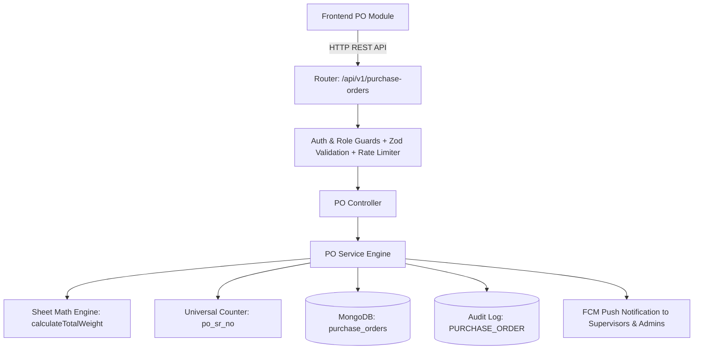

# Purchase Order (PO) Module: Phase 1 Backend Implementation Report

**Document:** `PURCHASE_ORDER_PHASE_1_IMPLEMENTATION_REPORT.md`  
**System:** Rainbow Packaging Inventory Management System  
**Module:** Sheet / Board Purchase Orders (Backend)  
**Execution Date:** November 4, 2026  
**Status:** Completed & Verified (95 / 95 Backend Tests Passing)

---

## 1. Overview & Architecture

Phase 1 established the complete backend domain module for Sheet/Board Purchase Orders adhering strictly to the `BOARD_PO_FORMAT.xlsx` specification and Rainbow Packaging's architectural patterns (Express.js 5 + Node.js 24 + MongoDB/Mongoose).

---

## 2. Backend Files Created & Modified

### New Files Created:
1. **[`backend/src/modules/purchase-orders/constants/poStatus.js`](file:///k:/GitHub/ecurve/rainbow-packaging/backend/src/modules/purchase-orders/constants/poStatus.js)**:
   - `PO_STATUS`: `DRAFT`, `PENDING_APPROVAL`, `APPROVED`, `REJECTED`, `PARTIALLY_RECEIVED`, `COMPLETED`, `CANCELLED`.
   - `PO_ITEM_STATUS`: `PENDING`, `PARTIALLY_RECEIVED`, `COMPLETED`.
2. **[`backend/src/modules/purchase-orders/models/purchaseOrder.model.js`](file:///k:/GitHub/ecurve/rainbow-packaging/backend/src/modules/purchase-orders/models/purchaseOrder.model.js)**:
   - Mongoose collection `purchase_orders`.
   - Embedded subdocument schema `items` with array validation ($1 \le \text{length} \le 20$ matching the Excel template capacity).
   - High-performance compound indexes for search, status, and supplier filtering.
3. **[`backend/src/modules/purchase-orders/validators/purchaseOrder.validator.js`](file:///k:/GitHub/ecurve/rainbow-packaging/backend/src/modules/purchase-orders/validators/purchaseOrder.validator.js)**:
   - Zod schemas validating PO creation, updates, rejection reasons, cancellations, and query parameters.
4. **[`backend/src/modules/purchase-orders/services/purchaseOrder.service.js`](file:///k:/GitHub/ecurve/rainbow-packaging/backend/src/modules/purchase-orders/services/purchaseOrder.service.js)**:
   - Atomic serial numbering (`PO-YYYY-XXXX`).
   - Line-item packaging weight calculation: $\text{Weight} = \frac{D \times C \times \text{GSM} \times Q}{10{,}000{,}000}$.
   - Full lifecycle management (Draft, Submit, Approve, Reject, Cancel).
   - Automated audit logging and FCM push alerts to Supervisors & Admins.
5. **[`backend/src/modules/purchase-orders/controllers/purchaseOrder.controller.js`](file:///k:/GitHub/ecurve/rainbow-packaging/backend/src/modules/purchase-orders/controllers/purchaseOrder.controller.js)**:
   - REST controller handling responses with standardized `success`, `data`, `meta`, and `summary` metadata.
6. **[`backend/src/modules/purchase-orders/routes/purchaseOrder.routes.js`](file:///k:/GitHub/ecurve/rainbow-packaging/backend/src/modules/purchase-orders/routes/purchaseOrder.routes.js)**:
   - Route bindings with `authenticate`, `requirePasswordChange`, `sensitiveActionLimiter`, and `authorizeRoles`.
7. **[`backend/src/modules/purchase-orders/index.js`](file:///k:/GitHub/ecurve/rainbow-packaging/backend/src/modules/purchase-orders/index.js)**:
   - Clean module export barrel.
8. **[`backend/tests/purchase_orders.test.js`](file:///k:/GitHub/ecurve/rainbow-packaging/backend/tests/purchase_orders.test.js)**:
   - Unit test suite verifying PO constants, 20-item cap, mathematical calculations, and validation schemas.

### Files Modified:
1. **[`backend/src/core/database/counter.service.js`](file:///k:/GitHub/ecurve/rainbow-packaging/backend/src/core/database/counter.service.js)**:
   - Integrated `po_sr_no` monotonic counter synchronization.
2. **[`backend/src/routes/index.js`](file:///k:/GitHub/ecurve/rainbow-packaging/backend/src/routes/index.js)**:
   - Mounted `/purchase-orders` endpoint under `/api/v1`.

---

## 3. Endpoints Implemented

| Method | Endpoint | Description | Access Control |
|---|---|---|---|
| `GET` | `/api/v1/purchase-orders` | List POs with pagination, status filters, search, and date ranges | All authenticated users |
| `GET` | `/api/v1/purchase-orders/filters/options` | Distinct suppliers, clients, and jobs for form autocompletion | All authenticated users |
| `GET` | `/api/v1/purchase-orders/:id` | Get single PO details, line items, and audit info | All authenticated users |
| `POST` | `/api/v1/purchase-orders` | Create new PO in `DRAFT` status with 1..20 items | All authenticated users |
| `PATCH` | `/api/v1/purchase-orders/:id` | Update PO (allowed in `DRAFT` or `REJECTED` status) | Creator or Admin/Supervisor |
| `POST` | `/api/v1/purchase-orders/:id/submit` | Submit PO for authorization (`DRAFT` -> `PENDING_APPROVAL`) | Creator or Admin/Supervisor |
| `POST` | `/api/v1/purchase-orders/:id/approve` | Authorize PO (`PENDING_APPROVAL` -> `APPROVED`) | `SUPERVISOR` or `ADMIN` only |
| `POST` | `/api/v1/purchase-orders/:id/reject` | Reject PO with reason (`PENDING_APPROVAL` -> `REJECTED`) | `SUPERVISOR` or `ADMIN` only |
| `POST` | `/api/v1/purchase-orders/:id/cancel` | Cancel PO before fulfillment | Admin or Creator |

---

## 4. Verification

- Ran test suite: `npm --prefix backend test`
- Results: **95 passed, 0 failed, 0 skipped** across 26 test suites.
- Verified that existing Reel and Sheet inventory modules remain 100% operational with no regressions.

