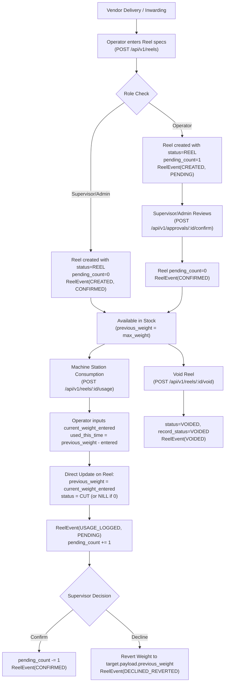

# Rainbow Packaging: Sheet (Board Stock) Inventory & Current System Audit

**Document:** `SHEET_INVENTORY_CURRENT_SYSTEM_AUDIT.md`  
**Generated Date:** November 3, 2026  
**Target Enterprise:** Rainbow Packages  
**Active Project:** Rainbow Packaging Inventory Management System  
**Repository Branch:** `rainbow-packaging-testing`  

---

## Executive Summary

Rainbow Packages is transitioning its packaging inventory platform from a Reel-centric tracking system into a multi-category modular monolith. The system currently runs in production for **Paper & Board Reels** (`modules/reels`), with initial architectural scaffolds already established for **Sheets / Board Stock** (`modules/sheets`) and **Finished Boxes** (`modules/finished-boxes`).

This audit inspects the existing codebase across backend and frontend, details the actual operational behavior of Reel Inventory, evaluates the company's real-world Excel register (`board-stock-sheet.xlsx`), contrasts the engineering differences between Reels and Sheets, outlines reusable versus module-specific components, identifies gaps, proposes database models and API blueprints, and raises key business decisions requiring stakeholder confirmation.

---

## 1. Project Architecture Overview

### 1.1 Architectural Pattern
The repository implements a **Domain-Driven Modular Monolith**:
- **Shared Platform Infrastructure (`backend/src/core/`)**: Cross-cutting concerns including authentication, authorization (RBAC), error handling (`ApiError`), centralized database transactions (`withTransaction`), atomic sequence numbering (`Counter`), audit logging, and email notifications.
- **Platform Feature Modules (`backend/src/modules/`)**: Shared operational domains including `auth`, `users`, `approvals`, `audit`, `notifications`, `settings`, `dashboard`, and `digest`.
- **Domain Inventory Modules (`backend/src/modules/`)**: Self-contained business categories:
  - `reels`: Production baseline for paper rolls (active).
  - `sheets`: Scaffolded domain for sheet-fed paper and corrugated boards (under development).
  - `finished-boxes`: Scaffolded domain for manufactured packaging goods (under development).

### 1.2 Technology Stack
| Layer | Technology | Details / Versions |
|---|---|---|
| **Backend Runtime** | Node.js (>=20) | ES Modules (`"type": "module"`) |
| **API Framework** | Express.js 5.2.1 | Central routing mounted at `/api/v1` via [backend/src/routes/index.js](file:///k:/GitHub/ecurve/rainbow-packaging/backend/src/routes/index.js) |
| **Database & ODM** | MongoDB Atlas / Mongoose 9.10.2 | Multi-document ACID transactions via MongoDB replica set sessions |
| **Validation** | Zod 4.6.5 | Request body & query parameter schema validation via [validate.js](file:///k:/GitHub/ecurve/rainbow-packaging/backend/src/core/middleware/validate.js) |
| **Frontend Framework** | React 19.2.8 / Vite 8.3.0 | Single Page Application (SPA) with React Router v7 (`react-router-dom: ^7.18.4`) |
| **UI Styling & Icons** | Tailwind CSS 4.3.3 / Lucide React | Modern responsive design, custom color tokens, status badges |
| **Spreadsheet Engine** | SheetJS (`xlsx: ^0.18.5`) | Client-side Excel reading & parsing in frontend |
| **Security & Logging** | Helmet 8.3.0, bcryptjs 3.0.3, Pino 10.3.1 | Secure headers, hashed passwords, structured logging |

### 1.3 Module Decoupling Principle
The architectural guideline strictly forbids monolithic leakage:
- Core (`backend/src/core/`) contains **zero** inventory-specific attributes (no GSM, BF, Deckle, or Reel numbers).
- Each inventory module maintains its own domain models, validators, controllers, and services.
- Shared services like `Counter` ([backend/src/core/database/counter.service.js](file:///k:/GitHub/ecurve/rainbow-packaging/backend/src/core/database/counter.service.js)) and `AuditLog` ([backend/src/modules/audit/models/auditLog.model.js](file:///k:/GitHub/ecurve/rainbow-packaging/backend/src/modules/audit/models/auditLog.model.js)) are generic and multi-module enabled.

---

## 2. Existing Inventory Module Architecture

### 2.1 Backend Registration & Routing
All routes are mounted uniformly in [backend/src/routes/index.js](file:///k:/GitHub/ecurve/rainbow-packaging/backend/src/routes/index.js#L20-L41):
```javascript
// Platform Services
router.use('/auth', authRoutes);
router.use('/users', userRoutes);
router.use('/approvals', approvalRoutes);
router.use('/dashboard', dashboardRoutes);
router.use('/audit', auditRoutes);
router.use('/digest', digestRoutes);
router.use('/settings', settingRoutes);

// Inventory Domains
router.use('/reels', reelRoutes);
router.use('/master-products', masterProductRoutes);
router.use('/master-codes', masterCodeRoutes);
router.use('/sheets', sheetRoutes);
router.use('/finished-boxes', boxRoutes);
```

### 2.2 Frontend Shells & Navigation
The application provides an entry portal selection screen ([frontend/src/pages/Modules/ModuleSelectPage.jsx](file:///k:/GitHub/ecurve/rainbow-packaging/frontend/src/pages/Modules/ModuleSelectPage.jsx)):
1. **Reels Domain**: Navigates to `/dashboard` wrapped inside the primary [AppShell.jsx](file:///k:/GitHub/ecurve/rainbow-packaging/frontend/src/components/Layout/AppShell.jsx).
2. **Sheets Domain**: Navigates to `/sheets/dashboard` wrapped inside a dedicated [SheetsAppShell.jsx](file:///k:/GitHub/ecurve/rainbow-packaging/frontend/src/modules/sheets/components/SheetsAppShell.jsx).
3. **Others**: Placeholder for additional categories.

The frontend route table in [frontend/src/App.jsx](file:///k:/GitHub/ecurve/rainbow-packaging/frontend/src/App.jsx#L77-L90) establishes dedicated routes for Sheets:
- `/sheets/dashboard` -> `SheetsDashboardPage`
- `/sheets/inventory` -> `SheetsPage`
- `/sheets/create` -> `CreateSheetPage`
- `/sheets/update` -> `UpdateSheetPage`
- `/sheets/messages` -> `SheetsMessagesPage`

---

## 3. Current Reel Inventory Lifecycle

The Reel module ([backend/src/modules/reels](file:///k:/GitHub/ecurve/rainbow-packaging/backend/src/modules/reels)) represents the production baseline. Its lifecycle operates as follows:



### 3.1 Item Identification & Attributes
- **Primary Physical ID**: `reel_no` (e.g. `1002`, `R-7801`). Entered manually from physical mill roll barcode/label. Unique among active reels ([reel.service.js#L795-L802](file:///k:/GitHub/ecurve/rainbow-packaging/backend/src/modules/reels/services/reel.service.js#L795-L802)).
- **Monotonic Sequential ID**: `sr_no` (Number). Auto-incremented atomically using [counter.service.js#L16-L43](file:///k:/GitHub/ecurve/rainbow-packaging/backend/src/core/database/counter.service.js#L16-L43) sequence `reel_sr_no`.
- **Classification Code**: `master_code` (e.g. `1` to `23` representing buckets like `Duplex ultra 220`, `SK-18-140`, `VK-25-180`, `FBB`, etc.).
- **Physical Specifications**:
  - `quality` (String): e.g., `ULTRA`, `DCB`, `SPECTRA`, `SK`, `VK`, `FBB`, `SBS`, `IMPORTANT`.
  - `gsm` (Mixed): e.g., `220`, `230/240`, `250+`.
  - `bf` (Mixed): Burst Factor, e.g., `18`, `22`, `ULTRA`, `DCB`.
  - `size` (Number): Reel deckle/width in centimeters.
  - `rate_per_kg` (Number): Purchase rate in INR per kg.
  - `max_weight` (Number): Original weight received on scale at delivery (kg).
  - `supplier_name` (String): Party / Paper trader name.
  - `mill_name` (String): Manufacturer mill.

### 3.2 Weight & Running Balance Tracking
- **The Balance Storage Mechanism**: In [reel.model.js#L20](file:///k:/GitHub/ecurve/rainbow-packaging/backend/src/modules/reels/models/reel.model.js#L20), the current balance is stored in the field **`previous_weight`**.
  - On creation: `previous_weight = max_weight` ([reel.service.js#L845](file:///k:/GitHub/ecurve/rainbow-packaging/backend/src/modules/reels/services/reel.service.js#L845)).
  - On consumption: The operator weighs the remaining reel returning from the corrugator/sheater station and inputs `current_weight_entered`.
  - The system computes: `used_this_time = reel.previous_weight - current_weight_entered` ([usage.service.js#L59](file:///k:/GitHub/ecurve/rainbow-packaging/backend/src/modules/reels/services/usage.service.js#L59)).
  - The system assigns: `reel.previous_weight = current_weight_entered` ([usage.service.js#L62](file:///k:/GitHub/ecurve/rainbow-packaging/backend/src/modules/reels/services/usage.service.js#L62)).
  - Status is derived ([reelStatus.js#L1-L10](file:///k:/GitHub/ecurve/rainbow-packaging/backend/src/modules/reels/utils/reelStatus.js)):
    - `REEL` if `previous_weight == max_weight`
    - `CUT` if `0 < previous_weight < max_weight`
    - `NILL` if `previous_weight == 0`

### 3.3 Stock Movement & Immutable History
- All movements are appended to the **`ReelEvent`** collection ([reelEvent.model.js](file:///k:/GitHub/ecurve/rainbow-packaging/backend/src/modules/reels/models/reelEvent.model.js)) via `appendEvent()` ([backend/src/core/services/eventLog.service.js](file:///k:/GitHub/ecurve/rainbow-packaging/backend/src/core/services/eventLog.service.js)).
- Event Types (`EVENT_TYPES`): `CREATED`, `USAGE_LOGGED`, `CONFIRMED`, `DECLINED_REVERTED`, `EDIT_APPLIED`, `VOIDED`.
- Machine Stations: `E-Flute`, `Narrow-Flute`, `Sheater`, `Sold to Revati`, `Return`, `Others` ([stations.js](file:///k:/GitHub/ecurve/rainbow-packaging/backend/src/modules/reels/constants/stations.js)).
- Concurrency Control: [usage.service.js#L33-L39](file:///k:/GitHub/ecurve/rainbow-packaging/backend/src/modules/reels/services/usage.service.js#L33-L39) checks `expected_previous_weight` to prevent race conditions.

### 3.4 Approval Workflow & Rollback Mechanics
- When an Operator inputs a creation or usage, `reel.pending_count` is incremented.
- However, **the weight balance update is applied to `reel.previous_weight` immediately** in the database.
- If Supervisor confirms: `pending_count` is decremented; a `CONFIRMED` event is recorded.
- If Supervisor declines: [approval.service.js#L436-L442](file:///k:/GitHub/ecurve/rainbow-packaging/backend/src/modules/approvals/services/approval.service.js#L436-L442) retrieves the prior balance from `targetEvent.payload.previous_weight` and restores `reel.previous_weight`, cascading declines across any newer unapproved events.

---

## 4. Existing Mongoose Models and Relationships

| Model | Collection | Purpose & Module | Multi-Module Reusable? |
|---|---|---|---|
| `Reel` | `reels` | Paper roll stock entity (`modules/reels`) | ❌ No. Highly reel-specific (`size` is width, `max_weight`, `stations_used`). |
| `ReelEvent` | `reelevents` | Audit ledger for roll creation, consumption, and edits | ❌ No. Hardcoded `reel_id: ObjectId ref Reel`, `reel_no: String`. |
| `MasterCode` | `mastercodes` | Grouping buckets for roll physical parameters | ⚠️ Partially. Buckets currently focus on paper qualities and BFs. |
| `MasterProduct` | `masterproducts` | Combinations of `quality`, `gsm`, `bf`, `size` | ❌ No. Tied to roll dimensions and BF. |
| `CorrectionRequest` | `correctionrequests` | Correction tickets submitted by operators | ❌ No. Schema explicitly references `reel_id`, `reel_no`, `max_weight`. |
| `Counter` | `counters` | Atomic monotonic sequence counter (`core/database`) | ✅ **Yes**. Already designed for `reel_sr_no`, `sheet_sr_no`, `finished_box_sr_no`. |
| `User` | `users` | System credentials and roles (`modules/users`) | ✅ **Yes**. Unified RBAC across all modules. |
| `RefreshToken` | `refreshtokens` | JWT session management (`modules/auth`) | ✅ **Yes**. Universal. |
| `AuditLog` | `audit_logs` | Universal immutable security/operations log (`modules/audit`) | ✅ **Yes**. Already has `module: ['REELS', 'SHEETS', 'FINISHED_BOXES', ...]`. |
| `Notification` | `notifications` | In-app alerts (`modules/notifications`) | ✅ **Yes**. Universal. |
| `Message` | `messages` | Internal operator/supervisor chat (`modules/notifications`) | ✅ **Yes**. Universal. |
| `DigestLog` | `daily_digests` | Daily summary email records (`modules/digest`) | ✅ **Yes**. Can incorporate sheet metrics. |
| `FieldDefinition` | `custom_field_definitions` | Dynamic fields created by Admin (`modules/settings`) | ⚠️ Needs domain scoping (currently all in one table). |
| `Setting` | `system_settings` | App-level settings e.g. aging threshold (`modules/settings`) | ✅ **Yes**. Universal. |
| `Sheet` *(Placeholder)* | `sheets` | Minimal scaffold (`modules/sheets/models/sheet.model.js`) | 🟡 Current model is an empty placeholder bag. |
| `FinishedBox` *(Placeholder)* | `finishedboxes` | Minimal scaffold (`modules/finished-boxes/models/finishedBox.model.js`) | 🟡 Current model is an empty placeholder bag. |

### 4.1 Is "Party" or "Customer" a Separate Model?
**NO.** There is no Party, Vendor, Supplier, or Customer collection anywhere in the database.
- In Reels, supplier names are stored as unvalidated strings in `reel.supplier_name`.
- Supplier dropdowns are generated on the fly via `Reel.distinct('supplier_name', { record_status: 'ACTIVE' })` ([reel.service.js#L1193](file:///k:/GitHub/ecurve/rainbow-packaging/backend/src/modules/reels/services/reel.service.js#L1193)).
- In the Sheet stock Excel register, Party Name is a central grouping attribute (`MAHALAXMI`, `MILTON`, `HALONIX`, `TTK`, `LUMINOUS`, etc.).

---

## 5. Existing API and Frontend Flow

### 5.1 API Endpoint Structure
All endpoints reside under `/api/v1`:

```
POST   /api/v1/auth/login                       # User authentication
GET    /api/v1/dashboard/summary                # Reel dashboard KPIs
GET    /api/v1/dashboard/status-board           # 3-column status board (REEL / CUT / NILL)
GET    /api/v1/reels                            # Paginated list of reels with aggregations
GET    /api/v1/reels/filters/options            # Distinct dropdown values
POST   /api/v1/reels                            # Inward new reel
GET    /api/v1/reels/:id                        # Reel detail & balance
PATCH  /api/v1/reels/:id                        # Admin direct update
POST   /api/v1/reels/:id/usage                  # Record station consumption
POST   /api/v1/reels/:id/void                   # Void / cancel reel
GET    /api/v1/approvals/pending                # Pending approval queue
POST   /api/v1/approvals/:id/confirm            # Confirm operator entry
POST   /api/v1/approvals/:id/decline            # Decline and revert entry
GET    /api/v1/sheets                           # Placeholder: returns empty list
```

### 5.2 Middleware Pipeline
Every authenticated request traverses:
1. `requestLogger` ([backend/src/core/middleware/requestLogger.js](file:///k:/GitHub/ecurve/rainbow-packaging/backend/src/core/middleware/requestLogger.js)): Pino structured logging.
2. `rateLimiter` ([backend/src/core/middleware/rateLimiter.js](file:///k:/GitHub/ecurve/rainbow-packaging/backend/src/core/middleware/rateLimiter.js)): IP rate throttling.
3. `authenticate` ([backend/src/core/middleware/authenticate.js](file:///k:/GitHub/ecurve/rainbow-packaging/backend/src/core/middleware/authenticate.js)): Verifies JWT bearer token or cookie; verifies user is active in DB.
4. `authorizeRoles(...roles)` ([backend/src/core/middleware/authorizeRoles.js](file:///k:/GitHub/ecurve/rainbow-packaging/backend/src/core/middleware/authorizeRoles.js)): Role check (`ADMIN`, `SUPERVISOR`, `OPERATOR`).
5. `validate({ body, query, params })` ([backend/src/core/middleware/validate.js](file:///k:/GitHub/ecurve/rainbow-packaging/backend/src/core/middleware/validate.js)): Zod schema enforcement.
6. `errorHandler` ([backend/src/core/middleware/errorHandler.js](file:///k:/GitHub/ecurve/rainbow-packaging/backend/src/core/middleware/errorHandler.js)): Maps `ApiError` instances to standardized HTTP responses.

### 5.3 User Roles & Operational Rights
- **`OPERATOR`**: Can create new inventory items, record usage/consumption, and submit correction requests. Entries are flagged `approval_status: PENDING` and increment `pending_count`.
- **`SUPERVISOR`**: Can review, confirm, or decline pending operator submissions. View-only access to inventory lists and dashboards.
- **`ADMIN`**: Unrestricted rights. Can directly modify parameters, void items, configure master codes, export stock valuation PDFs, and manage system users.

---

## 6. Existing Stock Calculation Mechanisms

### 6.1 Reel Stock Formulas
1. **Initial Weight**: `reel.max_weight` (Immutable physical weight).
2. **Current Remaining Stock**: `reel.previous_weight` (Running balance).
3. **Total Consumed Weight**: `reel.max_weight - reel.previous_weight`.
4. **Total Stock Value**: `reel.previous_weight * reel.rate_per_kg`.
5. **Station Consumption**:
   $$\text{used\_this\_time} = \text{previous\_weight} - \text{current\_weight\_entered}$$

### 6.2 Aggregation in `listReels` ([reel.service.js#L243-L275](file:///k:/GitHub/ecurve/rainbow-packaging/backend/src/modules/reels/services/reel.service.js#L243-L275))
The backend calculates totals on the fly using MongoDB aggregation facets:
```javascript
total_stock_weight: { $sum: '$previous_weight' },
total_consumed_weight: {
  $sum: {
    $max: [0, { $subtract: ['$max_weight', '$previous_weight'] }]
  }
},
total_stock_value: {
  $sum: {
    $multiply: ['$previous_weight', { $ifNull: ['$rate_per_kg', 0] }]
  }
}
```

---

## 7. Company Excel Register Analysis

The file **`board-stock-sheet.xlsx`** was inspected in detail. It contains the real-world operational stock register of Rainbow Packages as of **01-10-2026**.

### 7.1 Workbook Structure
- **Sheet Name**: `Sheet1`
- **Cell Range**: `A1:I43`
- **Header Row 1 (A1:I1 Merged)**: `"Stock of Board on 01-10-2026"`
- **Column Header Row 2 (A2:I2)**:
  1. `S.No` (Col A)
  2. `PARTY NAMRE` [sic] (Col B)
  3. `Job Name` (Col C)
  4. `Quality` (Col D)
  5. `Dackle(cm)` [sic] (Col E)
  6. `Cutting(cm)` (Col F)
  7. `GSM` (Col G)
  8. `Qty` (Col H)
  9. `Total wt (kg)` (Col I)
- **Data Rows (A3:I42)**: Exactly 40 data entries (S.No 1 to 40).
- **Summary Row 43 (A43:I43)**:
  - Cell G43: `"TOTAL"`
  - Cell H43: Formula `=SUM(H3:H42)` -> Value: **238,945 sheets**
  - Cell I43: Formula `=SUM(I3:I42)` -> Value: **30,985.33 kg** (~31 Tons)

### 7.2 The Exact Weight Formula
In every data row, the weight in Column I is computed by Excel formula:
$$\text{Cell I}_k = \frac{\text{Col E}_k}{100} \times \frac{\text{Col F}_k}{100} \times \frac{\text{Col G}_k}{1000} \times \text{Col H}_k$$
Simplifying algebraic terms:
$$\text{Weight (kg)} = \frac{\text{Deckle (cm)} \times \text{Cutting (cm)} \times \text{GSM} \times \text{Quantity}}{10,000,000}$$

**Dimensional Verification**:
- Deckle (cm) / 100 = Deckle in meters (m)
- Cutting (cm) / 100 = Cutting length in meters (m)
- Deckle (m) × Cutting (m) = Area per sheet ($m^2$)
- Area ($m^2$) × GSM ($g/m^2$) = Weight per sheet in grams (g)
- Weight per sheet (g) / 1000 = Weight per sheet in kilograms (kg)
- Total Weight (kg) = Weight per sheet (kg) × Quantity (sheets)

### 7.3 Data Profile & Key Observations

#### A. Parties (17 Distinct Clients)
`MAHALAXMI`, `RAJATDEEP`, `TUPPERWARE`, `LUMINOUS`, `PMS`, `WONDER`, `MILTON`, `HALONIX`, `HONEYWELL`, `EXIDE`, `US METAL`, `DESANA`, `TTK`, `PRINCE PIPE`, `CARBORUNDOM`, `RR`, and `MILTON & DESANA`.
- *Finding*: `MILTON & DESANA` (Row 27) combines two brands, representing a shared or co-branded production run.
- *Finding*: Row 20 (`CARBORUNDOM`) has an empty / blank `Job Name`.

#### B. Qualities (3 Distinct Grades)
- `ULTRA` (34 entries): Duplex Ultra board.
- `ANAND` (4 entries): Duplex board sourced from Anand paper mills.
- `FBB` (2 entries): Folding Box Board (virgin fiber).
- *Crucial Finding*: `ANAND` is **not** currently present in the Reel quality enum (`QUALITIES`). The Sheet module must support board-specific qualities.

#### C. Dimensions & Precision
- **Deckle (cm)**: Ranges from `20.25 cm` to `102.5 cm`. Many entries contain fractional decimals (`20.25`, `58.5`, `61.5`, `72.5`, `74.5`, `84.5`, `89.5`, `102.5`).
- **Cutting (cm)**: Ranges from `30.4 cm` to `103.0 cm`. Contains fractional decimals (`30.4`, `57.5`, `58.5`, `62.5`, `73.5`, `74.5`, `80.5`, `82.5`, `96.5`, `98.8`, `99.1`, `101.5`).
- **GSM**: Ranges from `220` to `330`. Distinct values: `220`, `230`, `240`, `260`, `263`, `270`, `280`, `296`, `300`, `320`, `330`.
  - Notice non-standard board GSMs like `263` and `296`.

#### D. Batch & Specification Duplication (Why Rows Must NOT Be Merged)
Examining the 40 rows shows that separate rows can share the same party, job, and dimensions, but represent distinct batches or different GSMs:
- **Rows 2 & 11**:
  - Row 2: `RAJATDEEP | CAS BIG | ANAND | 68 × 73.5 | 263 GSM | Qty: 3,888 | Wt: 511.07 kg`
  - Row 11: `RAJATDEEP | CAS BIG | ANAND | 68 × 73.5 | 270 GSM | Qty: 8,208 | Wt: 1,107.64 kg`
  *(Identical Party, Job, and Dimensions, but different GSM)*
- **Rows 4 & 39**:
  - Row 4: `LUMINOUS | SIZE -4 | ULTRA | 58 × 81 | 240 GSM | Qty: 19,008 | Wt: 2,143.19 kg`
  - Row 39: `LUMINOUS | SIZE - 4 | ULTRA | 57 × 81 | 240 GSM | Qty: 1,152 | Wt: 127.65 kg`
  *(Same customer and job, but slightly adjusted deckle: 58 cm vs 57 cm)*
- **Rows 17 & 34**:
  - Row 17: `TTK | 5 LTR | ULTRA | 91 × 73.5 | 240 GSM | Qty: 3,456 | Wt: 554.77 kg`
  - Row 34: `TTK | 5 LTR | ULTRA | 90 × 73.5 | 240 GSM | Qty: 4,608 | Wt: 731.57 kg`
- **Row 18 Formulation**:
  - In cell H18 (`DESANA | SINK COCK & SWAN NECK`), the quantity is entered as `=288+1296` (total 1,584). This proves that the shop floor aggregates physical bundles (e.g. 1 carton of 288 + 1 bundle of 1296) into a single row.

---

## 8. Sheet Inventory Business Requirements

Based on the spreadsheet analysis and packaging industry operations:

1. **Party & Job Association**: Unlike Reels (which are generic paper rolls purchased before job allocation), Sheets are almost exclusively ordered and stocked **per Party and per Job**. A sheet lot must be identifiable by Party Name and Job Name.
2. **Dual-Unit Tracking (Pieces + Weight)**:
   - Primary operational counting unit: **Pieces / Sheets** (`quantity` or `sheet_count`).
   - Financial & logistics unit: **Weight (kg)**, dynamically derived using the formula:
     $$\text{Weight} = \frac{\text{Deckle} \times \text{Cutting} \times \text{GSM} \times \text{Qty}}{10,000,000}$$
3. **Decimal Dimensions**: Deckle and Cutting must support 2 decimal places (Float/Double).
4. **Independent Lot / Batch Tracking**: Each row in the register represents a distinct physical lot. Identical specifications cannot be forcibly collapsed into one single record without losing lot traceability.
5. **Consumption Mechanism**: Consumption on printing and punching presses occurs in sheet quantities (e.g. 2,000 sheets issued to Die-Cutting). The system must deduct sheets and recalculate remaining kg.
6. **Conversion from Reels (Sheater Station)**: In the Reel module, one of the usage stations is `Sheater` ([stations.js](file:///k:/GitHub/ecurve\rainbow-packaging\backend\src\modules\reels\constants\stations.js)). When a paper reel is sent to the sheater, it is cut into flat sheets. The future system should ideally link Reel consumption at the Sheater to inwarded Sheet stock.

---

## 9. Reel vs Sheet Architectural Differences

| Operational & Architectural Dimension | Reels (`modules/reels`) | Sheets (`modules/sheets`) |
|---|---|---|
| **Primary Identifier** | Physical roll barcode / tag: `reel_no` (e.g. `1002`, `R-7801`). | Sheet Lot ID / Batch No + `party_name` + `job_name`. |
| **Primary Stock Metric** | **Weight (kg)** directly measured on scale. | **Piece Count (Number of Sheets)** counted in bundles. |
| **Secondary Metric** | Master code / roll size. | **Derived Weight (kg)** calculated via dimensional formula. |
| **Dimensions** | Single linear dimension: `size` (width in cm). | 2D surface dimensions: `deckle` (cm) × `cutting` (cm). |
| **Quality Grades** | Kraft & Duplex paper: `VK`, `SK`, `SPECTRA`, `DCB`, `ULTRA`, `IMPORTANT`. | Folding & Box Boards: `ULTRA`, `ANAND`, `FBB`, `SBS`, duplex boards. |
| **Burst Factor (BF)** | **Mandatory** strength rating for kraft rolls (`16`, `18`, `22`, `25`). | **Not applicable** to board sheets in the register. |
| **Consumption Input** | Operator enters new balance scale weight (`current_weight_entered`). | Operator enters sheets consumed or balance sheet count. |
| **Stock Statuses** | `REEL` (full), `CUT` (partially consumed), `NILL` (empty). | `IN_STOCK` (full/partial), `EXHAUSTED` (0 sheets), `VOIDED`. |
| **Physical Storage** | Individual rolls standing upright on shop floor. | Pallets, skids, bundles, or reams (e.g. 500 sheets/ream). |
| **Client Allocation** | Raw material stock is unallocated until corrugator run. | Stock is pre-allocated to specific client jobs (`MAHALAXMI`, `MILTON`, etc.). |
| **Valuation Metric** | `weight_in_stock * rate_per_kg`. | `(calculated_weight * rate_per_kg)` or `(sheet_count * rate_per_sheet)`. |

---

## 10. Reusable Existing Components

The modular monolith provides substantial infrastructure that should be directly reused:

1. **Atomic Counter Service** ([backend/src/core/database/counter.service.js](file:///k:/GitHub/ecurve/rainbow-packaging/backend/src/core/database/counter.service.js)):
   - Already includes the sequence name `'sheet_sr_no'` in its documentation comments. Can generate `sr_no` (1, 2, 3...) for sheets immediately.
2. **Universal Database Transaction Helper** ([backend/src/core/database/db.js](file:///k:/GitHub/ecurve/rainbow-packaging/backend/src/core/database/db.js)):
   - `withTransaction(async (session) => { ... })` ensures ACID consistency during inwarding, consumption, and cancellations.
3. **Authentication & RBAC Middleware** ([backend/src/core/middleware/authenticate.js](file:///k:/GitHub/ecurve/rainbow-packaging/backend/src/core/middleware/authenticate.js) & [authorizeRoles.js](file:///k:/GitHub/ecurve/rainbow-packaging/backend/src/core/middleware/authorizeRoles.js)):
   - Identical security enforcement for `ADMIN`, `SUPERVISOR`, and `OPERATOR`.
4. **Validation Pipeline** ([backend/src/core/middleware/validate.js](file:///k:/GitHub/ecurve/rainbow-packaging/backend/src/core/middleware/validate.js)):
   - Standardized Zod validation for request bodies and queries.
5. **Cross-Module Audit Log** ([backend/src/modules/audit/models/auditLog.model.js](file:///k:/GitHub/ecurve/rainbow-packaging/backend/src/modules/audit/models/auditLog.model.js)):
   - Contains `module: 'SHEETS'` and `resource_type: 'SHEET'`.
6. **Frontend App Shell Scaffold** ([frontend/src/modules/sheets/components/SheetsAppShell.jsx](file:///k:/GitHub/ecurve/rainbow-packaging/frontend/src/modules/sheets/components/SheetsAppShell.jsx)):
   - Dedicated navigation shell with mobile drawer, notifications icon, and module switching.
7. **Frontend Pagination Component** ([frontend/src/components/Common/Pagination.jsx](file:///k:/GitHub/ecurve/rainbow-packaging/frontend/src/components/Common/Pagination.jsx)):
   - Drop-in pagination controller matching the rest of the application.
8. **Client-side Excel Importer**:
   - `xlsx: ^0.18.5` is installed in `frontend` and ready for building an Excel file drag-and-drop parser.

---

## 11. Missing Capabilities

To support Sheet Inventory as an enterprise-grade module, the following capabilities are currently missing:

1. **Sheet Data Model**: Current [sheet.model.js](file:///k:/GitHub/ecurve/rainbow-packaging/backend/src/modules/sheets/models/sheet.model.js) is an empty placeholder schema with generic `attributes: Mixed`.
2. **Sheet Ledger / Events Collection**: No `SheetEvent` model exists. `ReelEvent` cannot be reused because it requires `reel_id: ObjectId ref Reel`.
3. **Party / Customer Entity**: Parties exist only as raw strings across independent records. There is no auto-complete dictionary or customer master.
4. **Dual-Unit Calculation Engine**: Backend and frontend lack utilities to convert `(Deckle × Cutting × GSM × Quantity) / 10,000,000` with rounding to 2 decimal places.
5. **Consumption API & Service**: No endpoint exists to deduct sheet quantities, calculate remaining sheet balances, or record machine stations (Offset Printing, Die Punching, Pasting).
6. **Sheet Approval Workflows**: The approvals module ([modules/approvals](file:///k:/GitHub/ecurve/rainbow-packaging/backend/src/modules/approvals)) is hardcoded to query `ReelEvent` and `Reel`. It cannot review sheet approvals without either refactoring or creating a dedicated sheet approval workflow.
7. **Excel Import API / Ingest Service**: No backend or frontend service exists to import `board-stock-sheet.xlsx` rows into database records.
8. **Reel-to-Sheet Sheater Conversion**: While reels track usage at the `Sheater` station, there is no link to automatically convert cut reels into sheet stock.

---

## 12. Potential Database Objects for Sheet Inventory

To maintain module independence and avoid polluting Reel collections, the following Mongoose schemas are recommended:

### 12.1 Proposed `Sheet` Model (`backend/src/modules/sheets/models/sheet.model.js`)
```javascript
{
  sr_no: { type: Number, required: true, unique: true },        // Monotonic ID (via getNextSequence('sheet_sr_no'))
  lot_no: { type: String, trim: true, index: true },           // Optional physical batch / pallet number
  party_name: { type: String, required: true, trim: true, index: true }, // e.g. 'MAHALAXMI'
  job_name: { type: String, trim: true, default: '', index: true },      // e.g. 'NEO BUG ZAPPER'
  quality: { type: String, required: true, trim: true, index: true },    // e.g. 'ULTRA', 'ANAND', 'FBB'
  deckle: { type: Number, required: true },                    // Deckle width in cm (e.g. 66.00)
  cutting: { type: Number, required: true },                   // Cutting length in cm (e.g. 100.00)
  gsm: { type: Number, required: true, index: true },          // Board GSM (e.g. 240)
  initial_quantity: { type: Number, required: true },          // Opening / received sheets
  current_quantity: { type: Number, required: true, min: 0 },  // Remaining balance sheets
  rate_per_kg: { type: Number, default: 0 },                   // Purchase price per kg
  rate_per_sheet: { type: Number, default: 0 },                // Purchase price per sheet
  initial_weight: { type: Number, required: true },            // Derived kg at creation
  current_weight: { type: Number, required: true, min: 0 },    // Derived kg at current balance
  status: {
    type: String,
    enum: ['AVAILABLE', 'PARTIALLY_CONSUMED', 'DEPLETED', 'VOIDED'],
    default: 'AVAILABLE',
    index: true,
  },
  supplier_name: { type: String, trim: true, default: '' },    // Board mill / supplier
  received_date: { type: Date, default: Date.now },
  sheater_reel_id: { type: mongoose.Schema.Types.ObjectId, ref: 'Reel', default: null }, // Link to parent reel if cut in-house
  custom_fields: { type: mongoose.Schema.Types.Mixed, default: {} },
  pending_count: { type: Number, default: 0 },
  record_status: { type: String, enum: ['ACTIVE', 'VOIDED'], default: 'ACTIVE', index: true },
  created_by: { type: mongoose.Schema.Types.ObjectId, ref: 'User', required: true },
}
```

### 12.2 Proposed `SheetEvent` Model (`backend/src/modules/sheets/models/sheetEvent.model.js`)
Modeled after `ReelEvent`, recording immutable transactions:
```javascript
{
  sheet_id: { type: mongoose.Schema.Types.ObjectId, ref: 'Sheet', required: true, index: true },
  sr_no: { type: Number, required: true },
  event_type: {
    type: String,
    enum: ['CREATED', 'CONSUMED', 'ADJUSTED', 'RETURNED', 'VOIDED', 'CONFIRMED', 'DECLINED'],
    required: true,
  },
  approval_status: { type: String, enum: ['PENDING', 'CONFIRMED', 'DECLINED', null], default: null },
  performed_by: { type: mongoose.Schema.Types.ObjectId, ref: 'User', required: true },
  performed_by_name: { type: String, required: true },
  performed_by_role: { type: String, required: true },
  performed_at: { type: Date, default: Date.now },
  approved_by: { type: mongoose.Schema.Types.ObjectId, ref: 'User', default: null },
  payload: {
    station: String,                // 'Offset Printing', 'Die Cutting', 'Pasting', 'Trim/Scrap'
    job_card_no: String,            // Production Job Card reference
    previous_quantity: Number,
    consumed_quantity: Number,
    remaining_quantity: Number,
    previous_weight: Number,
    consumed_weight: Number,
    remaining_weight: Number,
    notes: String,
  }
}
```

---

## 13. Potential API Requirements

### 13.1 Proposed Endpoints for Sheets Domain
| Method | Route | Access | Purpose |
|---|---|---|---|
| `GET` | `/api/v1/sheets` | Authenticated | Paginated sheet list with party, job, quality filters & summary KPIs. |
| `GET` | `/api/v1/sheets/summary` | Authenticated | Dashboard KPI aggregates (total sheets, total weight kg, valuation). |
| `GET` | `/api/v1/sheets/filters/options` | Authenticated | Dropdown lists of distinct parties, jobs, qualities, GSMs. |
| `GET` | `/api/v1/sheets/:id` | Authenticated | Single sheet record with dimensional specs and balance. |
| `GET` | `/api/v1/sheets/:id/journey` | Authenticated | Full movement/event history of the sheet lot. |
| `POST` | `/api/v1/sheets` | Operator / Admin | Inward a new sheet lot (calculates weight from dimensions). |
| `POST` | `/api/v1/sheets/import-excel` | Admin | Bulk upload sheet rows from Excel register. |
| `POST` | `/api/v1/sheets/:id/usage` | Operator / Admin | Record sheet consumption (deducts sheet count, re-derives weight). |
| `PATCH` | `/api/v1/sheets/:id` | Admin | Direct edit of sheet parameters (dimensions, party, rates). |
| `POST` | `/api/v1/sheets/:id/void` | Admin | Void/cancel a sheet lot. |

---

## 14. Potential Frontend Requirements

1. **Sheets Inventory List View (`SheetsPage.jsx`)**:
   - Data table displaying: `Sr. No`, `Party Name`, `Job Name`, `Quality`, `Deckle (cm)`, `Cutting (cm)`, `GSM`, `Balance Qty (pcs)`, `Total Weight (kg)`, `Status`, `Actions`.
   - Filter bar: Filter by Party Name, Job Name, Quality, GSM range, Date range.
   - Live KPI Banner: Matching Reels style (Total Sheet Lots, Available Sheets count, Total Weight in Tons, Total Valuation in ₹).
2. **Sheet Inwarding Modal / Page (`CreateSheetPage.jsx`)**:
   - Inputs for Party, Job Name, Quality, Deckle, Cutting, GSM, Quantity, Rate per kg.
   - **Real-time Live Calculation**: As user types Deckle, Cutting, GSM, and Quantity, dynamically calculate and display:
     - Area per sheet ($m^2$)
     - Weight per sheet (g and kg)
     - Total Lot Weight (kg)
     - Total Lot Valuation (₹)
3. **Sheet Consumption Modal (`RecordSheetUsageModal.jsx`)**:
   - Select station (`Offset Printing`, `Die Cutting`, `Pasting`, `Corrugation Liner`, `Scrap/Trim`).
   - Enter consumed sheet count.
   - Validate that consumed quantity $\le$ available balance.
   - Preview remaining sheet count and remaining kg balance.
4. **Excel Upload & Opening Stock Import Tool**:
   - File dropzone accepting `.xlsx`.
   - Table preview of parsed rows from `board-stock-sheet.xlsx`.
   - Validation highlights for missing job names or non-numeric dimensions.
   - Batch import button executing opening stock creation.

---

## 15. Data Migration & Opening Stock Considerations

### 15.1 Direct Ingestion of `board-stock-sheet.xlsx`
The company register contains 40 active stock lines. A migration script can ingest this file cleanly:
1. **Header Normalization**: Map `"PARTY NAMRE"` -> `party_name`, `"Job Name"` -> `job_name`, `"Dackle(cm)"` -> `deckle`, `"Cutting(cm)"` -> `cutting`, `"Qty"` -> `quantity`, `"Total wt (kg)"` -> `weight`.
2. **Date Extraction**: Extract opening stock date from cell A1 (`01-10-2026`).
3. **Data Cleansing**:
   - Trim whitespace on all party and job strings (e.g. `"PMS "` -> `"PMS"`).
   - If `Job Name` is missing (Row 20 `CARBORUNDOM`), set to `"GENERAL / UNASSIGNED"`.
   - For combined party names (Row 27 `MILTON & DESANA`), retain as a valid string or split if requested.
   - Evaluate formula expressions (e.g. Row 18 `=288+1296` evaluates to `1584`).
4. **Re-calculating Weight vs Excel Stored Weight**:
   - Excel uses float approximations (e.g. `1368.576`, `511.0674912`).
   - The backend should round calculated weight to 2 decimal places (`1368.58 kg`, `511.07 kg`) for financial and reporting consistency.
5. **Initial Transaction Generation**:
   - Each imported row generates a `Sheet` record (`status: AVAILABLE`) and a corresponding initial `SheetEvent` (`event_type: CREATED, approval_status: CONFIRMED, notes: 'Opening Stock from Excel Register'`).

---

## 16. Unresolved Business Questions

The following operational and business questions require confirmation from the company before development:

1. **Party / Customer Master**:
   - Should Party Name remain a free-text string (like `supplier_name` in Reels), or should we introduce a standardized Master Party / Customer table with predefined names and autocomplete?
2. **Quality Catalog**:
   - The register introduces `ANAND` as a quality alongside `ULTRA` and `FBB`. Are board qualities separate from paper roll qualities, or should they share a common quality master?
3. **Ream vs Sheet Counting**:
   - Does the shop floor ever count stock in Reams (500 sheets/ream) or Cartons/Bundles, or will stock always be recorded strictly in individual sheet piece counts?
4. **Reel-to-Sheet Sheater Integration**:
   - When a Paper Reel is consumed at the `Sheater` machine station, should the system provide a feature to automatically convert consumed reel kg into newly inwarded board sheets, or will sheet inwarding always be recorded manually?
5. **Approval Workflow for Sheets**:
   - Should Sheet inwarding and consumption follow the exact same Operator $\rightarrow$ Supervisor $\rightarrow$ Admin approval pipeline as Reels (where Operator logs are pending until approved), or should sheet entries be auto-confirmed?
6. **Rate & Pricing Visibility**:
   - The Excel register does not include purchase rate per kg or rate per sheet. Will rate fields be added for Sheets to enable stock valuation, and should they follow the same strict UI hiding rules as Reel suppliers?
7. **Scrap & Trim Waste Tracking**:
   - When sheets are die-cut, significant board scrap is generated. Does the company need to track scrap weight or trim loss percentage during sheet consumption?

---

## 17. Recommended Implementation Approach

To extend the system safely without destabilizing the working Reel production module:

### Phase 1: Database Foundation (Sheets Domain)
- Define `Sheet` schema in [backend/src/modules/sheets/models/sheet.model.js](file:///k:/GitHub/ecurve/rainbow-packaging/backend/src/modules/sheets/models/sheet.model.js).
- Define `SheetEvent` schema in `backend/src/modules/sheets/models/sheetEvent.model.js`.
- Add atomic counter key `'sheet_sr_no'` in [counter.service.js](file:///k:/GitHub/ecurve/rainbow-packaging/backend/src/core/database/counter.service.js).
- Implement standard dimensional weight calculation utilities in `backend/src/modules/sheets/utils/sheetCalculations.js`.

### Phase 2: Service & REST API Layer
- Implement `sheet.service.js` with `listSheets`, `getSheet`, `createSheet`, `recordSheetUsage`, and `getFilterOptions`.
- Write Zod validators in `sheet.validator.js`.
- Connect routes in `sheet.routes.js` with RBAC authorization.

### Phase 3: Opening Stock Ingestion
- Create an administrative script (`scripts/importSheetsFromExcel.js`) to migrate the 40 records from `board-stock-sheet.xlsx` into MongoDB.
- Verify total sheet count equals 238,945 pcs and total weight equals 30,985.33 kg.

### Phase 4: Frontend Operational UI
- Build `SheetsPage.jsx` table with real-time KPI tiles.
- Implement `CreateSheetModal.jsx` / `CreateSheetPage.jsx` with live dimensional weight calculations.
- Implement `RecordSheetUsageModal.jsx` for deducting sheet counts on job runs.
- Wire API calls in `sheetApi.js`.

### Phase 5: Verification & End-to-End Testing
- Ensure automated backend test suite continues to pass 100%.
- Add dedicated automated tests for sheet weight calculations, inwarding, and consumption.
- Verify Vite frontend bundle compiles with 0 errors.

---
*End of Audit Document — Prepared for Rainbow Packaging System Architecture Team.*

