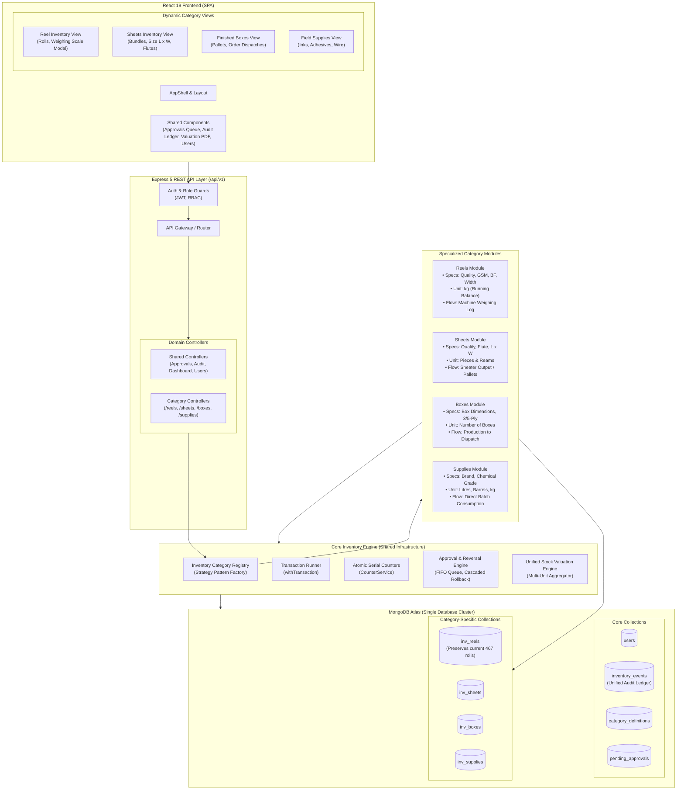

# Rainbow Packaging Inventory System — Complete Technical Audit & Upgrade Architecture Analysis

**Authoritative Technical Audit & Upgrade Blueprint**  
**Document File**:  `docs/Rainbow_Packaging_Inventory_Audit_and_Upgrade_Analysis.md`  
**Project**: Rainbow Packaging Reel Inventory & Management System  
**Date**: October 2026  
**Audit Status**: Complete, Verified Against Codebase  
**Execution Mode**: Non-Destructive Inspection (Zero Code / Schema / Config Modifications Made)

---

## Table of Contents

1. [Executive Summary](#1-executive-summary)
2. [Technology Stack and Repository Structure](#2-technology-stack-and-repository-structure)
3. [Current Functionality and Implementation Status](#3-current-functionality-and-implementation-status)
4. [Frontend Architecture](#4-frontend-architecture)
5. [Backend Architecture](#5-backend-architecture)
6. [Database Schema and Inventory Data Model](#6-database-schema-and-inventory-data-model)
7. [Existing API and End-to-End Data Flow](#7-existing-api-and-end-to-end-data-flow)
8. [Current Inventory Workflows](#8-current-inventory-workflows)
9. [Confirmed Requirements vs. Unknown Business Requirements](#9-confirmed-requirements-vs-unknown-business-requirements)
10. [Technical Debt, Defects, and Architectural Risks](#10-technical-debt-defects-and-architectural-risks)
11. [Architecture Options Comparison (Options A, B, C, D)](#11-architecture-options-comparison)
12. [Recommended Target Architecture](#12-recommended-target-architecture)
13. [Concrete Walkthrough: Introducing a New Product Category](#13-concrete-walkthrough-introducing-a-new-product-category)
14. [Proposed Database and API Changes](#14-proposed-database-and-api-changes)
15. [Phased Implementation Roadmap](#15-phased-implementation-roadmap)
16. [Business Decisions Requiring Company Input](#16-business-decisions-requiring-company-input)
17. [Testing and Data Migration Strategy](#17-testing-and-data-migration-strategy)
18. [Final Recommendation and Next Steps](#18-final-recommendation-and-next-steps)

---

## 1. Executive Summary

### 1.1 Context and Audit Mandate
Rainbow Packaging previously commissioned a custom web-based inventory management system designed to solve a pressing operational bottleneck: tracking physical paper and board rolls ("reels") across shopfloor machine stations (corrugators, sheeters, and external processing). The company now plans to expand the application to support additional product categories—specifically flat corrugated sheets, finished boxes/cartons, field-related materials, and auxiliary production items (e.g., adhesives, ink, stitching wire, tooling).

Before any code is altered or new database structures are introduced, this technical audit was performed under strict non-destructive constraints to:
1. Systematically inspect the entire codebase (frontend, backend, database layer, configuration, documentation, tests, and production scripts).
2. Establish an evidence-based feature-by-feature implementation scorecard.
3. Deconstruct the existing inventory data model and uncover its hardcoded assumptions.
4. Evaluate architectural upgrade strategies to accommodate multi-category inventory without repetitive rewrites.
5. Provide a phased, risk-mitigated technical roadmap and identify prerequisite business decisions.

### 1.2 Core Audit Findings
1. **The System is Exclusively a "Reel" System**: Despite references in documentation to generalized concepts, the active application domain is 100% hardwired around paper rolls. Every collection, route, form, validator, calculation, and UI component assumes the physical item is a roll with paper-specific attributes: Quality (`VK`, `SPECTRA`, `ULTRA`, `SK`, `DCB`, `FBB`, `SBS`), Bursting Factor (`bf`), Grams per Square Metre (`gsm`), Roll Width (`size`), and Roll Weight in kilograms (`max_weight`, `previous_weight`).
2. **Current State of Implementation**: The core reel tracking workflow (receiving single reels or bulk Excel uploads, weighing remaining balance after machine station runs, calculating consumed kg, supervisor approval queues, cascaded rollback on decline, admin corrections, and client-side PDF/Excel export) is **implemented and functional**.
3. **Severe Conceptual Disconnect in Master Codes / Master Keys**: Earlier architecture specifications mandated a strict system-generated `master_key` (`QualityCode-GsmCode-BfCode-SizeCode`). Later client adjustments introduced business-defined "buckets" called `master_code` (Codes 1–18, e.g. "Duplex ultra 220"). In git commit `7992f31` ("jo hoga so dekha jayega"), `master_key` was commented out from the Mongoose schemas (`reel.model.js` and `masterProduct.model.js`), yet legacy backend queries, services, and tests still actively reference, query, and generate `master_key`.
4. **Missing Production Safety and Tests**: Backend integration tests for the primary business domains (`reels.test.js`, `approvals.test.js`, `auth.test.js`, `dashboard.test.js`, `usage.test.js`, `users.test.js`) are 1-line empty stubs. `node-cron` and `nodemailer` are referenced dynamically in background services but omitted from `backend/package.json` dependencies. Passwords are stored in plaintext in the database (`plain_password` on `user.model.js`) to satisfy a manual viewing requirement.
5. **Architectural Viability for Expansion**: The current application **cannot directly accept new product categories** in its present schema. Forcing sheets or field goods into the existing `Reel` schema would corrupt stock valuations, report aggregates, and machine station workflows. However, the system's modular Express structure, decoupled React UI, and MongoDB document model make it an ideal candidate for evolution into a **Configurable Modular Monolith (Option C)** using a **Core Inventory Registry + Specialized Category Modules** pattern.

---

## 2. Technology Stack and Repository Structure

### 2.1 Technology Stack Summary

| Layer | Technology | Version | Purpose & Responsibilities |
|---|---|---|---|
| **Frontend Framework** | React | `^19.2.8` | UI view rendering, state-driven user interactions, dynamic modals |
| **Frontend Routing** | React Router DOM | `^7.18.4` | Declarative client-side routing, route-level role authorization guards |
| **Styling & Design System** | Tailwind CSS / PostCSS | `^4.3.3` | Utility-first responsive styling, dark/light theme tokens |
| **Icons** | Lucide React | `^1.48.0` | Comprehensive iconography across navigation, actions, and status indicators |
| **Spreadsheet Processing** | SheetJS (`xlsx`) | `^0.18.5` | In-browser parsing of uploaded Excel files and client-side XLSX/CSV export |
| **Build Tooling** | Vite | `^8.3.0` | Rapid ESM frontend development server and Rollup production bundler |
| **Linter** | Oxlint | `^1.81.0` | High-performance static code quality and lint inspection |
| **Backend Framework** | Node.js / Express | `^5.2.1` | REST API orchestration, middleware pipeline, HTTP envelope handling |
| **Database ODM** | Mongoose | `^9.10.2` | Object Document Mapping, schema definition, indexes, transactions |
| **Database Engine** | MongoDB Atlas | Cluster 8.0+ | Hosted document database (`reel_inventory_dev` / `reel_inventory_prod`) |
| **Schema Validation** | Zod | `^4.6.5` | Strict schema validation for request bodies, query strings, and params |
| **Security & Auth** | JWT (`jsonwebtoken`) | `^9.0.3` | Dual-token authentication (short-lived access + persistent refresh tokens) |
| **Password Hashing** | bcryptjs | `^3.0.3` | Salted hashing for credential storage |
| **Rate Limiting** | express-rate-limit | `^8.7.0` | IP-based request throttling on authentication and API routes |
| **Security Headers** | Helmet | `^8.3.0` | HTTP security response headers protection |
| **Logging** | Pino & Pino-HTTP | `^10.3.1` | Structured JSON application logging with request correlation |
| **API Documentation** | Swagger UI Express | `^5.0.1` | OpenAPI 3.0 interactive API documentation mounted at `/api/v1/docs` |
| **Serverless Bridge** | serverless-http | `^4.0.0` | Express adapter enabling serverless deployment (e.g., Vercel / Netlify) |

### 2.2 Repository Directory Layout

```text
rainbow-packaging/
├── backend/
│   ├── api/
│   │   └── index.js                      # Serverless entry point (serverless-http)
│   ├── docs/
│   │   ├── routes/                       # Markdown specifications for all 43 API endpoints
│   │   ├── API_OVERVIEW.md               # API convention and error envelope specifications
│   │   └── DATABASE_DESIGN.md            # Initial Mongoose schema and index design document
│   ├── scripts/                          # Database seeders, migrations, index creators, test harness
│   ├── src/
│   │   ├── config/                       # Environment (Zod), db (Mongoose/Transactions), Pino logger, Swagger
│   │   ├── constants/                    # Enums: roles, reelStatus, eventTypes, approvalStatus, stations
│   │   ├── controllers/                  # 14 HTTP controllers unpacking requests into service calls
│   │   ├── jobs/                         # Daily digest cron schedule (dynamic node-cron import)
│   │   ├── middleware/                   # JWT auth, role guard, rate limiter, Zod validate, errorHandler
│   │   ├── models/                       # 13 Mongoose schemas: Reel, ReelEvent, MasterCode, MasterProduct, etc.
│   │   ├── routes/                       # Express route definitions mounted under /api/v1
│   │   ├── services/                     # Core business logic, transactional operations, aggregations
│   │   ├── templates/                    # HTML and plain-text daily digest email generators
│   │   ├── utils/                        # Master key generator, reelStatus derivation, pagination, filters
│   │   ├── validators/                   # 14 Zod validation schemas enforcing body and query parameters
│   │   ├── app.js                        # Express application instance, CORS, middleware, route mounting
│   │   └── server.js                     # HTTP server startup, DB connection, keep-alive initializer
│   ├── tests/                            # Node.js native test runner test suite
│   ├── package.json
│   └── vercel.json                       # Vercel serverless deployment configuration
├── frontend/
│   ├── dist/                             # Compiled production assets
│   ├── public/                           # Manifest, service worker, static favicon assets
│   ├── src/
│   │   ├── api/                          # 15 Axios/fetch client modules wrapping /api/v1 endpoints
│   │   ├── assets/                       # Static branding and SVG icons
│   │   ├── auth/                         # AuthContext (React context), ProtectedRoute, RoleGuard
│   │   ├── components/
│   │   │   ├── Common/                   # Reusable UI widgets: Modal, DatePicker, Toast, Pagination, Table
│   │   │   └── Layout/                   # AppShell, TopNav, Sidebar, Footer, Navigation items
│   │   ├── pages/
│   │   │   ├── Approvals/                # Supervisor & Admin confirmation queues, ReelJourneyModal
│   │   │   ├── Audit/                    # System audit trail logs and event filtering
│   │   │   ├── ChangePassword/           # Forced password reset and voluntary credential update
│   │   │   ├── CustomFields/             # FieldDefinition manager for dynamic reel parameters
│   │   │   ├── Dashboard/                # Metric tiles, aging reels, status boards, quality charts
│   │   │   ├── Digest/                   # Daily digest manual trigger, preview, and log breakdown
│   │   │   ├── Errors/                   # 403 Forbidden and 404 Not Found error screens
│   │   │   ├── Login/                    # User authentication screen with quick action hints
│   │   │   ├── MasterCodes/              # Business master code management (Codes 1–18+)
│   │   │   ├── MasterProducts/           # Aggregated stock valuation by technical specification
│   │   │   ├── Messages/                 # Inter-role internal messaging and correction proposals
│   │   │   ├── Notifications/            # System notifications and decision alert feeds
│   │   │   ├── Reels/                    # CreateReel, BulkUpload, ReelList, RecordUsage, VoidReel
│   │   │   ├── Settings/                 # Global app settings (aging threshold, digest schedules)
│   │   │   └── Users/                    # User management, role assignment, password unlocks
│   │   ├── utils/                        # formatters.js (currency, weights, dates, master code spec parsing)
│   │   ├── App.jsx                       # Master React router view tree
│   │   ├── index.css                     # Tailwind CSS directives and custom styling tokens
│   │   ├── main.jsx                      # React 19 application mount point (DOM root)
│   │   └── StoreContext.jsx              # Unused prototype mock state (dead code)
│   ├── package.json
│   ├── vite.config.js
│   └── netlify.toml                      # Netlify client redirect and SPA routing configuration
├── docs/                                 # High-level business and technical documentation
│   ├── BUSINESS_GUIDE.md                 # Owner and supervisor bilingual operational overview
│   ├── SYSTEM_MASTER_DOCUMENTATION.md    # System Master Documentation v2.0.0
│   └── TECHNICAL_ARCHITECTURE.md         # Deployment and architectural specification
├── 06-10-2026.xlsx                       # Historical production reel inventory export
├── 10-10-2026 DATA.xlsx                  # Production reel dataset update
├── ORIGINAL DATA FOR SOFTWARE.xlsx       # Baseline migration dataset (409 paper reels)
├── package.json                          # Unified root monorepo scripts for Render / Netlify
└── render.yaml                           # Infrastructure as Code deployment blueprint for Render
```

---

## 3. Current Functionality and Implementation Status

### 3.1 Status Classification Taxonomy
Features are evaluated against the following strict classification system:
1. **Fully implemented and verified**: Production-ready, frontend and backend integrated, validated with live database transactions.
2. **Implemented but only partially verified**: Code is present and functioning in standard flows, but lacks automated tests or has untested edge cases.
3. **Partially implemented**: Core functionality exists, but critical secondary capabilities (e.g. error recovery, cascade handling) are incomplete.
4. **Frontend only**: UI exists, but connects to mocks or has no backend endpoint backing it.
5. **Backend only**: REST API and database logic exist, but no user-facing frontend screen is built.
6. **Planned or documented but not implemented**: Detailed in design docs or schemas, but no executable code exists.
7. **Not found**: Mentioned in requirements or requested by business, but completely absent from the repository.
8. **Blocked or impossible to verify**: Cannot be validated without unavailable external third-party infrastructure.

### 3.2 Feature-by-Feature Scorecard

| # | Feature Name | Business Purpose | Frontend Status | Backend Status | Database Support | API Integration | Validation & Errors | Test Coverage | Status Assessment | Primary Files / Objects |
|---|---|---|---|---|---|---|---|---|---|---|
| **1** | **User Authentication & Session Management** | Secure login, JWT issuance, refresh rotation, role enforcement | Complete (`LoginPage.jsx`, `AuthContext.jsx`) | Complete (`auth.controller.js`, `auth.service.js`) | Complete (`User`, `RefreshToken`) | Complete (`/auth/login`, `/auth/refresh`, `/auth/me`, `/auth/logout`) | Zod validated; handles 401 refresh seamlessly | 1-line stub (`auth.test.js`); verified live via token tests | **Implemented but only partially verified** | `frontend/src/auth/AuthContext.jsx`<br>`backend/src/services/auth.service.js` |
| **2** | **Role-Based Access Control (RBAC)** | Restrict rights between `OPERATOR`, `SUPERVISOR`, `ADMIN` | Complete (`RoleGuard.jsx`, UI conditional tabs) | Complete (`authorizeRoles.js`) | Role enum on `User` model | Complete across all protected endpoints | Strict 403 Forbidden response on unauthorized role | Verified manually; no automated RBAC tests | **Implemented but only partially verified** | `frontend/src/auth/RoleGuard.jsx`<br>`backend/src/middleware/authorizeRoles.js` |
| **3** | **Single Reel Creation** | Inward a new physical paper reel into warehouse | Complete (`CreateReelPage.jsx`, `CreateReelModal.jsx`) | Complete (`createReel` in `reel.service.js`) | Complete (`Reel`, `Counter`, `ReelEvent`) | Complete (`POST /reels`) | Zod validated; detects duplicate `reel_no` | Zero unit/integration tests for creation | **Implemented but only partially verified** | `frontend/src/pages/Reels/CreateReelPage.jsx`<br>`backend/src/services/reel.service.js` |
| **4** | **Bulk Excel Reel Inwarding** | Bulk inwarding of hundreds of reels via spreadsheet | Complete (client-side `XLSX` parse + preview grid) | Complete (`bulkCreateReels` in `reel.service.js`) | Complete (`Reel`, `Counter`, `ReelEvent`) | Complete (`POST /reels/bulk`) | Validates headers, rejects row duplicates, skips active duplicates | Verified through migration scripts (`import_original_data.js`) | **Fully implemented and verified** | `frontend/src/pages/Reels/CreateReelPage.jsx`<br>`backend/src/services/reel.service.js:611` |
| **5** | **Inventory List, Filtering & Search** | Real-time warehouse catalog with chip filters and text search | Complete (`ReelListPage.jsx` with multi-filter bar) | Complete (`listReels`, `buildReelFilter.js`) | Full composite indexes on `Reel` collection | Complete (`GET /reels`) | Validated pagination and query params | Pagination and filter tests passing (37 assertions) | **Fully implemented and verified** | `frontend/src/pages/Reels/ReelListPage.jsx`<br>`backend/src/utils/buildReelFilter.js` |
| **6** | **Continuous Shopfloor Weight Usage** | Operators record remaining weight after machine runs | Complete (`RecordUsageModal.jsx` with 300ms debounce) | Complete (`recordUsage` in `usage.service.js`) | Complete (`Reel`, `ReelEvent`) | Complete (`POST /reels/:id/usage`) | Enforces `current_weight < previous_weight`; optimistic lock | 1-line stub (`usage.test.js`) | **Implemented but only partially verified** | `frontend/src/pages/Reels/RecordUsageModal.jsx`<br>`backend/src/services/usage.service.js` |
| **7** | **Multi-Role Approvals & Cascaded Revert** | Supervisors confirm/decline operator inwarding & usage | Complete (`ApprovalsPage.jsx`, `OperatorApprovalsPage.jsx`) | Complete (`approval.service.js` with transactions) | Complete (`ReelEvent` FIFO queue) | Complete (`POST /approvals/:id/confirm`, `/decline`) | Strict FIFO sequence validation per reel | 1-line stub (`approvals.test.js`) | **Implemented but only partially verified** | `frontend/src/pages/Approvals/ApprovalsPage.jsx`<br>`backend/src/services/approval.service.js` |
| **8** | **Master Reel Weight Correction** | Admin overrides incorrect baseline or weight readings | Complete (`MasterCorrectionModal.jsx`) | Complete (`updateReel` in `reel.service.js`) | Complete (`ADMIN_CORRECTED` event in `ReelEvent`) | Complete (`PATCH /reels/:id`) | Rejects if reel has pending approvals; writes audit diff | Unverified by automated tests | **Implemented but only partially verified** | `frontend/src/pages/Reels/MasterCorrectionModal.jsx`<br>`backend/src/services/reel.service.js:896` |
| **9** | **Reel Voiding (Single & Bulk)** | Cancel or decommission physical rolls without hard deletion | Complete (`VoidReelModal.jsx`, `BulkVoidReelModal.jsx`) | Complete (`voidReel`, `bulkVoidReels`) | Soft deletion flag (`RECORD_STATUS.VOIDED`) | Complete (`POST /reels/:id/void`, `/bulk-void`) | Admin-only role authorization guard | Zero automated tests | **Implemented but only partially verified** | `frontend/src/pages/Reels/VoidReelModal.jsx`<br>`backend/src/services/reel.service.js:1030` |
| **10** | **Business Master Codes (Codes 1–18+)** | High-level categorization buckets for operators | Complete (`MasterCodeListPage.jsx`, details modal) | Complete (`masterCode.service.js`) | Complete (`MasterCode` collection, 25 docs in DB) | Complete (`/master-codes` CRUD endpoints) | Zod validated; unique `master_code` index | 6 passing unit tests in `masterCode.test.js` | **Fully implemented and verified** | `frontend/src/pages/MasterCodes/MasterCodeListPage.jsx`<br>`backend/src/services/masterCode.service.js` |
| **11** | **Technical Master Products & Keys** | Technical specification grouping (`Quality-GSM-BF-Size`) | Complete (`MasterProductListPage.jsx`) | Broken / Inconsistent (`masterProduct.service.js`) | Disabled index; `master_key` commented out | Complete (`GET /master-products`) | Schema allows unindexed spec grouping | Master key generator unit tests pass (5 tests) | **Partially implemented** | `backend/src/models/masterProduct.model.js`<br>`backend/src/utils/masterKeyGenerator.js` |
| **12** | **Operator Correction Requests & Messages** | Operators propose spec edits or message supervisors | Complete (`ComposeMessagePage.jsx`, Request modal) | Complete (`correction.service.js`, `message.service.js`) | Complete (`CorrectionRequest`, `Message`, `Notification`) | Complete (`/corrections`, `/messages`, `/notifications`) | Zod validated; links to `Reel` and target recipient | Zero automated tests; verified manual flow | **Implemented but only partially verified** | `frontend/src/pages/Messages/ComposeMessagePage.jsx`<br>`backend/src/services/correction.service.js` |
| **13** | **Executive Dashboard & Valuation Metrics** | Warehouse tiles (total stock kg, value ₹, aging reels) | Complete (`DashboardPage.jsx`, 3-column status board) | Complete (`dashboard.service.js` aggregation pipeline) | MongoDB `$facet` aggregation over active reels | Complete (`GET /dashboard/summary`, `/status-board`) | Validated; checks `pending_count === 0` | 1-line stub (`dashboard.test.js`) | **Implemented but only partially verified** | `frontend/src/pages/Dashboard/DashboardPage.jsx`<br>`backend/src/services/dashboard.service.js` |
| **14** | **Reel Journey Timeline Drilldown** | Complete lifecycle audit trail for a physical roll | Complete (`ReelJourneyModal.jsx`, `ReelDetailPage.jsx`) | Complete (`getReelJourney` in `reel.service.js`) | Query on `ReelEvent` sorted by `performed_at: 1` | Complete (`GET /reels/:id/journey`) | Sanitized; links users, approvals, and diffs | Unverified by automated tests | **Implemented but only partially verified** | `frontend/src/pages/Approvals/ReelJourneyModal.jsx`<br>`backend/src/services/reel.service.js` |
| **15** | **Custom Field Definitions** | Dynamically define additional parameters for reels | Complete (`CustomFieldsPage.jsx`) | Complete (`fieldDefinition.service.js`) | Schema exists (`FieldDefinition`), 0 records in DB | Complete (`/field-definitions` CRUD) | Zod validated; checks key regex `[a-z][a-z0-9_]*` | Unverified; no active documents in production | **Implemented but only partially verified** | `frontend/src/pages/CustomFields/CustomFieldsPage.jsx`<br>`backend/src/models/fieldDefinition.model.js` |
| **16** | **PDF Stock Valuation & Export** | Filtered stock valuation report for printing or PDF save | Complete (`openPrintReport` in `ReelListPage.jsx`) | None (handled client-side) | None | N/A (fetches all pages and prints via DOM) | Client-side HTML escaping and table formatting | Verified manual browser print dialog | **Frontend only** | `frontend/src/pages/Reels/ReelListPage.jsx:298-360` |
| **17** | **Spreadsheet Export (XLSX / CSV)** | Export filtered inventory to Excel or CSV | Complete (`handleExportSpreadsheet` using SheetJS) | None (handled client-side) | None | N/A (uses client-side `XLSX.writeFile`) | Client-side column mapping and file generation | Verified manual file generation | **Frontend only** | `frontend/src/pages/Reels/ReelListPage.jsx:595-658` |
| **18** | **Daily Digest Email Dispatcher** | Scheduled daily summary email of reel movements | Complete (`DailyDigestPage.jsx` preview & manual send) | Implemented (`digest.service.js`, `email.service.js`) | Complete (`DigestLog` collection) | Complete (`/digest/preview`, `/send`, `/logs`) | Validates SMTP parameters; simulates if unconfigured | Unit tests for email template rendering pass | **Implemented but only partially verified** | `backend/src/services/digest.service.js`<br>`backend/src/services/email.service.js` |
| **19** | **Automatic Cron Scheduler** | Periodic background trigger for daily digest at 20:00 | None | Broken (`backend/src/jobs/index.js`) | `Setting` model stores schedule (`20:00`) | Internal background timer | Catches missing `node-cron` package gracefully | Unverified; `node-cron` not in `package.json` | **Partially implemented** | `backend/src/jobs/index.js:45-56`<br>`backend/package.json` |
| **20** | **Historical Event Log Editing** | Admin editing of previous weight readings on events | Complete (`EditReelEventModal.jsx`) | Defective (`updateReelEvent` in `reel.service.js`) | Updates single event payload only | Complete (`PATCH /reels/events/:eventId`) | Restricted to `ADMIN` role | Unverified; does NOT ripple changes to current reel weight | **Partially implemented** (Contains logic defect) | `backend/src/services/reel.service.js:1237-1317` |
| **21** | **Sheet Inventory Management** | Stock tracking of cut corrugated sheets (L x W, flutes) | Not Found | Not Found | Not Found | Not Found | Not Found | Not Found | **Not found** | N/A |
| **22** | **Carton / Box Inventory Management** | Stock tracking of finished goods, bundles, pallet quantities | Not Found | Not Found | Not Found | Not Found | Not Found | Not Found | **Not found** | N/A |
| **23** | **Field Materials & Supplies Management** | Consumables tracking (ink, starch adhesive, stitching wire) | Not Found | Not Found | Not Found | Not Found | Not Found | Not Found | **Not found** | N/A |
| **24** | **Production Conversion (Reel to Sheets)** | Work order converting paper roll kg into sheet count | Not Found | Not Found | Not Found | Not Found | Not Found | Not Found | **Not found** | N/A |
| **25** | **Multi-Warehouse / Location Tracking** | Physical storage bin, aisle, rack, or multi-plant separation | Not Found | Not Found | Not Found | Not Found | Not Found | Not Found | **Not found** | N/A |

### 3.3 Overall Implementation Quantification

To avoid arbitrary percentage estimates, implementation completeness is computed using two transparent methodologies:

#### Methodology A: Current Reel Scope (Features 1 to 20)
- **Total Features**: 20
- **Fully Implemented & Verified**: 4 (20.0%)
- **Implemented but Only Partially Verified**: 11 (55.0%)
- **Partially Implemented / Defective**: 3 (15.0%)
- **Frontend Only**: 2 (10.0%)
- **Planned / Not Found**: 0 (0.0%)
- *Summary*: 15 of 20 features (75.0%) are fully or substantively implemented for paper reels, with 15.0% impaired by architectural stubs or edge defects, and 10.0% executed purely in the browser without dedicated backend export endpoints.

#### Methodology B: Enterprise Expanded Scope (Features 1 to 25, including proposed categories)
- **Total Features**: 25
- **Implemented (Verified + Partially Verified)**: 15 (60.0%)
- **Impaired / Defective**: 3 (12.0%)
- **Frontend Only**: 2 (8.0%)
- **Completely Missing / Not Found**: 5 (20.0%)
- *Summary*: Exactly 0.0% of sheet, finished carton, consumable, production conversion, or multi-warehouse capabilities currently exist in the software.

---

## 4. Frontend Architecture

### 4.1 Framework, Entry Point, and Build Pipeline
- **Framework**: React 19 (`react: ^19.2.8`, `react-dom: ^19.2.8`).
- **Bundler**: Vite 8 (`vite: ^8.3.0`, `@vitejs/plugin-react: ^6.1.1`).
- **Entry Points**: `frontend/index.html` mounts `frontend/src/main.jsx`, which initializes React StrictMode and renders `frontend/src/App.jsx`.
- **Styling**: Tailwind CSS v4 using PostCSS. UI tokens feature responsive dark/light theme classes with accessible contrast ratios.
- **Build Output**: Compiles into `frontend/dist/assets/index-[hash].js` (1.18 MB) and `index-[hash].css` (120.9 KB). (Note: Build generates a warning regarding chunks exceeding 500 KB; code-splitting via `React.lazy()` is currently omitted).

### 4.2 Application Shell and Navigation
The application layout is centralized in `frontend/src/components/Layout/AppShell.jsx`:
- **Desktop Sidebar**: Collapsible navigation bar with state stored in `localStorage.getItem('rp_sidebar_collapsed')`.
- **Role-Filtered Navigation Links**: Navigation items dynamically hide/show based on user role:
  - `OPERATOR`: Dashboard, Reel Inventory, Create Reel, Weight Usage, My Submitted Approvals, Messages, Notifications.
  - `SUPERVISOR`: Dashboard, Reel Inventory, Master Codes, Pending Approvals Queue, Messages, Notifications.
  - `ADMIN`: Full access, including User Management, Custom Fields, Daily Digest, Audit Trail, Global Settings.
- **Header Utilities**: Displays authenticated user name, active role badge (`OPERATOR`, `SUPERVISOR`, `ADMIN`), unread notification bell badge, pending correction counter, and dark-mode toggle.

### 4.3 Routing and Security Guards
Client-side routing in `frontend/src/App.jsx` uses `react-router-dom` v7:
- **`ProtectedRoute.jsx`**: Validates `isAuthenticated` from `AuthContext`. If unauthenticated, saves attempted location and redirects to `/login`.
- **`RoleGuard.jsx`**: Inspects `user.role` against `allowedRoles`. If the user lacks access, redirects to `/403` (ForbiddenPage).
- **Forced Password Reset**: While backend has `requirePasswordChange.js` middleware, the frontend lacks an automatic redirect to `/change-password` if `user.must_change_password === true`.

### 4.4 State Management and Dead Code
- **Active State Architecture**: State is distributed locally across pages using React hooks (`useState`, `useEffect`, `useCallback`, `useMemo`). Shared application state (authentication, tokens, active profile) is managed exclusively via React Context in `frontend/src/auth/AuthContext.jsx`.
- **Dead Code Finding**: `frontend/src/StoreContext.jsx` is an obsolete in-memory mock store (270 lines) holding hardcoded users and dummy reels. It is not imported or referenced anywhere in `frontend/src/` and should be excised.

### 4.5 API Client Layer
API interactions are encapsulated in `frontend/src/api/client.js` with 14 domain-specific modules:
- Configured with `BASE_URL = import.meta.env.VITE_API_BASE_URL || '/api/v1'`.
- Intercepts 401 Unauthorized responses to perform automatic token rotation using `POST /api/v1/auth/refresh`.
- Queues parallel in-flight requests during refresh and retries them upon receipt of a new access token.
- Dispatches custom browser event `auth:unauthorized` to trigger clean session purge if refresh fails.

---

## 5. Backend Architecture

### 5.1 Framework, Language, and Entry Points
- **Language / Runtime**: Node.js (v20+ required by `engines`), ES Modules (`"type": "module"` in `package.json`).
- **Framework**: Express 5.2.1 (`express: ^5.2.1`).
- **Server Entry Point**: `backend/src/server.js` connects to MongoDB Atlas, starts the HTTP listener on `PORT=5000`, and initializes the keep-alive ping service.
- **Serverless Adapter**: `backend/api/index.js` wraps the Express app using `serverless-http` for serverless environments (Netlify / Vercel).

### 5.2 Middleware Pipeline Structure
Requests flow sequentially through `backend/src/app.js`:
```text
[Incoming HTTP Request]
         │
         ▼
[pinoHttp Logging] ─────────► Structured request/response logging
         │
         ▼
[Helmet Security] ──────────► Content security headers, HSTS, frame protection
         │
         ▼
[CORS Configuration] ───────► Whitelists FRONTEND_URL with credentials support
         │
         ▼
[express.json({10mb})] ─────► JSON body parsing (10 MB cap for bulk uploads)
         │
         ▼
[cookieParser] ─────────────► Parses refresh cookies
         │
         ▼
[apiRateLimiter] ───────────► 300 requests/minute per IP
         │
         ▼
[/api/v1 Routes] ───────────► Router pipeline
         │
         ▼
[Centralized errorHandler] ─► Maps Mongoose, Zod, and Mongo 11000 errors into standard envelope
```

### 5.3 Route Middleware Guards
Endpoints mounted under `backend/src/routes/` apply layered security guards:
1. `authenticate.js`: Extracts `Bearer <token>` from Authorization header. Verifies signature via `JWT_ACCESS_SECRET`. Verifies user exists in database and `is_active === true`.
2. `requirePasswordChange.js`: Blocks write operations if `user.must_change_password === true`, returning HTTP 403 `PASSWORD_CHANGE_REQUIRED`.
3. `authorizeRoles(...roles)`: Verifies `req.user.role` matches authorized permissions.
4. `validate(schema)`: Validates `req.body`, `req.query`, and `req.params` against Zod schemas. Attaches sanitized data to `req.validated`.

### 5.4 Controller-Service-Repository Pattern
The backend enforces functional layer separation:
- **Controllers** (`backend/src/controllers/`): Strictly unpack `req.validated`, extract `req.user` as `actor`, delegate execution to service functions, and format HTTP envelopes (`{ success: true, data, meta }`).
- **Services** (`backend/src/services/`): Pure business logic. Manages transactions via `withTransaction`, performs multi-collection joins, enforces optimistic concurrency checks, and creates audit events.
- **Models / Data Access** (`backend/src/models/`): Mongoose schemas act as the repository layer, defining field types, defaults, validation setters (e.g. `roundTwoDecimals`), and compound database indexes.

---

## 6. Database Schema and Inventory Data Model

### 6.1 Database Engine and Active Collections
The system runs on **MongoDB Atlas** with database environments partitioned into `reel_inventory_dev` (development) and `reel_inventory_prod` (production).

Inspection of the live database reveals 13 registered collections:

| Collection Name | Document Count | Business Purpose | Critical Indexes |
|---|---|---|---|
| `reels` | 467 docs | Physical paper roll records and running balance | `reel_no: 1`, `{ status: 1, quality: 1 }`, `{ record_status: 1, master_code: 1 }` |
| `reelevents` | 471 docs | Immutable audit ledger of all roll transactions | `{ reel_id: 1, performed_at: 1 }`, `{ approval_status: 1, performed_at: 1 }` |
| `mastercodes` | 25 docs | High-level business classification buckets (Codes 1–18+) | `master_code: 1` (unique), `{ status: 1, master_code: 1 }` |
| `masterproducts` | 222 docs | Technical specification grouping | `{ quality: 1, gsm: 1, bf: 1, size: 1 }` (unique), `master_code_id: 1` |
| `users` | 3 docs | User authentication profiles | `username: 1` (unique), `email: 1` (sparse unique), `{ role: 1, is_active: 1 }` |
| `refreshtokens` | 11 docs | Hashed refresh tokens for JWT rotation | `token_hash: 1`, `expires_at: 1` (TTL automatic purge) |
| `counters` | 1 docs | Atomic sequence generator for reel serial numbers | `_id: 1` (`reel_sr_no`) |
| `settings` | 1 docs | Application settings (`_id: 'app'`) | Primary key `_id` |
| `correctionrequests` | 0 docs | Operator-submitted specification correction proposals | `{ status: 1, created_at: -1 }`, `{ reel_id: 1, status: 1 }` |
| `messages` | 0 docs | Internal communications between operators and supervisors | `{ recipient_id: 1, status: 1 }`, `{ created_at: -1 }` |
| `notifications` | 0 docs | User notification alerts | `{ user_id: 1, is_read: 1, created_at: -1 }` |
| `fielddefinitions` | 0 docs | Dynamic custom parameter definitions | `{ key: 1 }` (unique), `{ is_active: 1, order: 1 }` |
| `digestlogs` | 0 docs | Daily digest dispatch history | `{ digest_date: 1 }` (unique) |

### 6.2 Data Model Analysis: Reel Entity (`reel.model.js`)

```javascript
// Actual Schema Definition (backend/src/models/reel.model.js)
{
  sr_no: { type: Number, required: true, unique: true },          // Sequential integer ID
  reel_no: { type: String, required: true, trim: true },          // Physical roll barcode/tag (e.g. "809", "R-1002")
  quality: { type: String, required: true, trim: true },          // Paper grade: VK, SK, ULTRA, DUPLEX, etc.
  bf: { type: mongoose.Schema.Types.Mixed, required: true },       // Bursting Factor (Number: 18, 22 or String: "ULTRA")
  purchase_date: { type: Date, required: true, default: Date.now },// Purchase / Inwarding date
  supplier_name: { type: String, required: true, trim: true },    // Supplier / Party name (default: "Self / Stock")
  mill_name: { type: String, trim: true, default: '' },           // Paper mill manufacturer
  size: { type: Number, required: true, set: roundTwoDecimals },  // Reel width in cm/inches
  gsm: { type: mongoose.Schema.Types.Mixed, required: true },      // Grams per Square Metre (Number: 120 or String: "230/240")
  rate_per_kg: { type: Number, default: 0 },                      // Unit valuation price per kg (₹)
  max_weight: { type: Number, required: true },                   // Initial gross weight at inwarding (kg)
  previous_weight: { type: Number, required: true },              // CURRENT running stock balance (kg)
  status: { type: String, required: true, enum: ['REEL','CUT','NILL'] }, // Derived inventory state
  custom_fields: { type: mongoose.Schema.Types.Mixed, default: {} }, // Dynamic parameters
  master_product_id: { type: ObjectId, ref: 'MasterProduct' },    // Reference to technical spec
  // master_key: { type: String },                                // COMMENTED OUT in schema
  master_code_id: { type: ObjectId, ref: 'MasterCode' },          // Reference to business bucket
  master_code: { type: String, trim: true },                      // Cached master code string (e.g. "1")
  stations_used: { type: [String], default: [] },                 // Machine stations that consumed this roll
  pending_count: { type: Number, default: 0 },                    // Active pending events awaiting approval
  record_status: { type: String, enum: ['ACTIVE','VOIDED'], default: 'ACTIVE' },
  last_activity_at: { type: Date, default: Date.now },
  created_by: { type: ObjectId, ref: 'User', required: true }
}
```

### 6.3 Critical Field Naming Anomaly: `previous_weight` vs. `current_weight`
A critical architectural revelation from the code inspection:
- In `reel.model.js`, there is **no `current_weight` column**.
- When an operator records usage on a reel, the input parameter is named `current_weight_entered`.
- In `backend/src/services/usage.service.js` (line 62):
  ```javascript
  reel.previous_weight = current_weight_entered;
  reel.status = deriveReelStatus({ previous_weight: reel.previous_weight, max_weight: reel.max_weight });
  ```
- **Consequence**: In this codebase, the field `previous_weight` on the `Reel` document **actually stores the current available balance**! The historical previous weight prior to the entry is preserved only inside the `payload.previous_weight` attribute of the `ReelEvent` document. This counter-intuitive naming poses a severe cognitive risk for future developers.

### 6.4 The 4-Level Data Hierarchy and the Master Code / Master Key Schism
The documentation describes a 4-level hierarchy:
```text
Business Master Code (e.g. "7" / "SK-18-180")
         │
         ▼
Technical Master Key (e.g. "SK-G180-BF18-S100") ──► MasterProduct
         │
         ▼
Physical Reel Number (e.g. "R-2201") ──────────────► Reel
         │
         ▼
Reel Events (Receive, Usage, Return) ─────────────► ReelEvent
```

#### The Schism:
1. **Original Design**: Material specifications were canonicalized into `master_key` (`VK-G120-BF18-S100`).
2. **Shopfloor Pivot**: Plant workers found 20-character technical keys unworkable. Management introduced **18 Master Code Buckets** (e.g. `Master Code 1: Duplex ultra 220`, `Master Code 6: SK-16-100`).
3. **The Schema Hack**: To stop Mongoose duplicate key errors during Excel imports where multiple reels had non-standard BFs or GSMs, a developer commented out `master_key` from both `reel.model.js` and `masterProduct.model.js` (Commit `7992f31`).
4. **Current Inconsistency**: 
   - `MasterProduct.find({ master_key: ... })` queries a field that is commented out of the schema.
   - `masterProductSchema.index({ quality: 1, gsm: 1, bf: 1, size: 1 }, { unique: true })` now enforces technical uniqueness instead of `master_key`.
   - The query builder `buildReelFilter.js` and search routes still attempt to search `{ master_key: regex }`.

---

## 7. Existing API and End-to-End Data Flow

### 7.1 Complete Route Catalog (43 Endpoints Mounted Under `/api/v1`)
The Express API registers 43 REST endpoints across 14 route modules:

1. **Health (1)**: `GET /health`
2. **Auth (6)**: `POST /auth/login`, `POST /auth/refresh`, `POST /auth/logout`, `POST /auth/logout-all`, `GET /auth/me`, `POST /auth/change-password`
3. **Users (7)**: `GET /users`, `POST /users`, `GET /users/:id`, `PATCH /users/:id`, `PATCH /users/:id/status`, `POST /users/:id/reset-password`, `POST /users/:id/unlock`
4. **Reels (14)**: `GET /reels`, `GET /reels/search`, `GET /reels/next-number`, `GET /reels/filter-options`, `GET /reels/usage/logs`, `GET /reels/:id`, `GET /reels/:id/journey`, `POST /reels`, `POST /reels/bulk`, `POST /reels/:id/usage`, `PATCH /reels/:id`, `POST /reels/:id/void`, `POST /reels/bulk-void`, `PATCH /reels/events/:eventId`
5. **Approvals (4)**: `GET /approvals/pending`, `GET /approvals/mine`, `POST /approvals/:eventId/confirm`, `POST /approvals/:eventId/decline`
6. **Master Codes (3)**: `GET /master-codes`, `POST /master-codes`, `PUT /master-codes/:id`
7. **Master Products (2)**: `GET /master-products`, `GET /master-products/:id`
8. **Dashboard (4)**: `GET /dashboard/summary`, `GET /dashboard/status-board`, `GET /dashboard/breakdown`, `GET /dashboard/aging`
9. **Notifications (4)**: `GET /notifications`, `GET /notifications/unread-count`, `PATCH /notifications/read-all`, `PATCH /notifications/:id/read`
10. **Messages (2)**: `GET /messages`, `POST /messages`
11. **Corrections (5)**: `GET /corrections`, `POST /corrections`, `GET /corrections/pending-count`, `GET /corrections/:id`, `POST /corrections/:id/resolve`
12. **Field Definitions (3)**: `GET /field-definitions`, `POST /field-definitions`, `PATCH /field-definitions/:id`
13. **Audit (1)**: `GET /audit/events`
14. **Digest & Settings (5)**: `GET /digest/preview`, `POST /digest/send`, `GET /digest/logs`, `GET /settings`, `PATCH /settings`

### 7.2 End-to-End Execution Trace: Recording Reel Usage
To verify architectural integrity, here is the complete trace of the most critical transaction—an operator recording consumption on a paper roll:

```text
1. Frontend Interaction (RecordUsageModal.jsx):
   - Operator scans or types "809" into debounced search box.
   - Frontend calls GET /api/v1/reels/search?q=809.
   - User selects reel (displays previous_weight: 1000 kg).
   - Operator selects Station "E-Flute", enters remaining weight "850" kg, and clicks "Submit".

2. HTTP Request Dispatch (reelApi.js -> client.js):
   - Method: POST /api/v1/reels/6ac4b326f193edd861040482/usage
   - Headers: Authorization: Bearer <jwt_access_token>
   - Payload: { station: "E-Flute", current_weight_entered: 850, expected_previous_weight: 1000 }

3. Express Middleware Pipeline:
   - authenticate: Decodes JWT, attaches req.user (role: OPERATOR, name: "Store (Operator)").
   - requirePasswordChange: Checks must_change_password (false => pass).
   - authorizeRoles(OPERATOR, SUPERVISOR, ADMIN): Role matches => pass.
   - validate(recordUsageSchema): Validates station in STATIONS enum, current_weight_entered >= 0.

4. Controller Layer (reel.controller.js -> recordUsage):
   - Extracts req.params.id, req.validated, req.user as actor.
   - Passes to usage.service.js: recordUsage({ id, input, actor }).

5. Business Logic & Database Transaction (usage.service.js):
   - Opens Mongoose transaction via withTransaction(async (session) => ...).
   - Finds Reel by ID inside session: Reel.findById(id).session(session).
   - Optimistic Concurrency Guard:
     Math.abs(reel.previous_weight - input.expected_previous_weight) <= 0.01 (passes).
   - Pending Lock Guard: Checks reel.pending_count === 0 (passes).
   - Weight Validity Check: 0 <= 850 < 1000 (passes).
   - Derives Consumed Weight: used_this_time = 1000 - 850 = 150 kg.
   - Updates Reel:
     reel.previous_weight = 850;
     reel.status = 'CUT';
     reel.stations_used.push('E-Flute');
     reel.pending_count = 1; // Operator action requires supervisor confirmation
     await reel.save({ session });
   - Appends Immutable Event (eventLog.service.js):
     Creates ReelEvent document:
     {
       reel_id: reel._id,
       reel_no: "809",
       event_type: "USAGE_LOGGED",
       approval_status: "PENDING",
       performed_by: actor.id,
       performed_by_name: actor.name,
       performed_by_role: "OPERATOR",
       payload: {
         station: "E-Flute",
         previous_weight: 1000,
         current_weight_entered: 850,
         used_this_time: 150
       }
     }
   - Commits transaction atomically.

6. Controller Response:
   - Returns HTTP 200 OK:
     {
       success: true,
       data: {
         reel: { id: "...", reel_no: "809", previous_weight: 850, status: "CUT", pending_count: 1 },
         event: { id: "...", approval_status: "PENDING" }
       }
     }

7. Frontend Reconciliation:
   - Modal catches 200 response, displays green confirmation banner, refreshes parent table,
     and remains open for the operator to weigh the next reel in the sequence.
```

---

## 8. Current Inventory Workflows

### 8.1 Workflow Matrix

```text
┌────────────────────────────────────────────────────────────────────────┐
│                        1. INWARDING WORKFLOW                           │
│  [Physical Roll Received] ──► Select Master Code ──► System Prefills   │
│  Operator enters Reel #, Weight ──► Created (PENDING Supervisor Conf)  │
└───────────────────────────────────┬────────────────────────────────────┘
                                    │
                                    ▼
┌────────────────────────────────────────────────────────────────────────┐
│                        2. CONSUMPTION WORKFLOW                         │
│  Operator runs Roll on Machine (E-Flute, Sheater, Narrow-Flute)        │
│  Operator returns Roll to Scale ──► Enters Remaining Balance           │
│  Weight & Status updated immediately ──► Added to Pending Queue        │
└───────────────────────────────────┬────────────────────────────────────┘
                                    │
                                    ▼
┌────────────────────────────────────────────────────────────────────────┐
│                        3. SUPERVISOR DECISION                          │
│          ┌────────────────────────┴────────────────────────┐           │
│          ▼                                                 ▼           │
│     [CONFIRM]                                          [DECLINE]       │
│  Pending Count -> 0                             Reverts Balance Weight │
│  Event marked CONFIRMED                         Later events cascaded  │
│                                                 Operator notified      │
└────────────────────────────────────────────────────────────────────────┘
```

### 8.2 The Reversible Immediate Effect Pattern
The system employs an **Immediate Effect with Reversible Auditing** design:
1. When an operator records usage, warehouse stock is deducted **immediately** so downstream operators see the depleted balance on the shopfloor right away.
2. The reel is locked against further usage (`pending_count > 0`).
3. If the supervisor confirms the entry: `pending_count` is decremented to 0, and the lock is released.
4. If the supervisor declines the entry (e.g. scale misread): the backend retrieves `event.payload.previous_weight`, restores `reel.previous_weight = 1000`, recalculates status (`REEL`), marks any subsequent pending events as `DECLINED` (cascaded revert), and creates a notification alert for the operator.

### 8.3 Inwarding / Receiving Workflow
- **Single Inwarding**: Operator chooses a Master Code (e.g. `Code 1`). Form autofills Quality (`DUPLEX`), BF (`ULTRA`), GSM (`220`). Operator enters barcode/tag number (`reel_no`), gross weight (`max_weight`), purchase date, and supplier.
- **Bulk Spreadsheet Inwarding**: User drops an `.xlsx` sheet into `CreateReelPage.jsx`. The browser parses the sheet, matches headers (`Quality`, `Size`, `Weight`, `GSM`, `BF`, `Head/MasterCode`), validates each row, displays an in-browser editable preview table, and transmits the batch via `POST /api/v1/reels/bulk`. Active duplicates in the database are automatically identified, skipped, and reported in the response summary.

### 8.4 Stock Valuation & Reporting Workflow
- Valuation is dynamically aggregated:
  $$\text{Stock Value} = \sum (\text{previous\_weight} \times \text{rate\_per\_kg})$$
- Average Price per kg is calculated dynamically:
  $$\text{Avg Price/kg} = \frac{\text{Total Stock Value}}{\text{Total Stock Weight}}$$
- All filtering, PDF generation, and Excel exports execute against these formulas.

---

## 9. Confirmed Requirements vs. Unknown Business Requirements

To ensure architectural integrity, we must strictly delineate confirmed operational rules from unverified assumptions regarding the proposed expansion into sheets, boxes, and field materials.

### 9.1 Confirmed Requirements (Direct Code & Document Evidence)
1. **Paper Reels are Tracked by Discrete Serial Barcode**: Every roll has a distinct `reel_no`.
2. **Reels Track Running Weight Balance**: Unit of measurement is strictly kilograms (kg), rounded to 2 decimal places.
3. **Paper Rolls Have 4 Fixed Physical Dimensions**: Quality (Grade), GSM (Density), BF (Strength), and Size (Width).
4. **Master Codes Represent 18+ Business Categories**: Admins and supervisors create new master codes dynamically.
5. **Multi-Role Separation**: Operators create/consume; supervisors approve/decline; admins perform master corrections and user administration.
6. **Machine Stations Are Fixed**: E-Flute, Narrow-Flute, Sheater, Sold to Revati, Return, Others.
7. **Reel Status is Derived Server-Side**:
   - `REEL`: `previous_weight == max_weight` (Unused)
   - `CUT`: `0 < previous_weight < max_weight` (Partially consumed)
   - `NILL`: `previous_weight == 0` (Depleted)

### 9.2 Unknown Business Requirements Requiring Clarification

| Category / Domain | Unanswered Business Question | Why It Affects Architecture & Implementation |
|---|---|---|
| **Sheets Inventory** | What defines a "Sheet" item? Are sheets tracked individually or in bundles/pallets/reams? | Barcode tracking per individual sheet is physically impossible; data model must support batch/lot tracking with bundle or pallet quantities. |
| **Sheets Dimensions** | Do sheets have 2 physical dimensions (Length $\times$ Width) instead of 1 (Reel Size / Width)? | The existing `size` column is a single scalar number. Sheets require `length` and `width` in cm or inches. |
| **Sheets Unit of Measure** | How is sheet stock counted: by number of sheets (pieces), weight (kg), or both? | If tracked by piece count and valued by weight, a real-time weight conversion formula based on area and GSM ($\text{Area} \times \text{GSM} / 10,000$) is required. |
| **Production Conversion** | When a Reel is cut at the "Sheater" station, does the system automatically create Sheet inventory? | If yes, this introduces **Bill of Materials (BOM) / Production Conversion Workflows**, linking consumed raw material (kg) to finished goods output. |
| **Wastage & Trim Scrap** | During reel slitting or corrugation, is trim wastage and scrap tracked separately? | Determines whether usage forms require a "Scrap/Wastage kg" input field to prevent unexplained inventory shrink. |
| **Finished Boxes / Cartons** | Does Rainbow Packaging stock finished corrugated boxes? | Boxes require SKU codes, flute types (3-ply, 5-ply, 7-ply), customer references, and sales dispatch workflows. |
| **Field-Related Inventory** | What does "field-related" mean? Does it refer to items dispatched to client sites, agricultural packaging, or consumable plant supplies? | If it refers to consumables (ink, glue, strapping), it uses batch-expiry and direct consumption without machine station tracking. |
| **Warehouse Locations** | Are sheets, boxes, and reels stored in the same shed or different warehouses? | Adding multi-warehouse tracking requires a `warehouse_id` or `location_code` (Aisle/Rack/Bin) across all stock models. |
| **Valuation & Costing** | How are sheets and boxes costed: per thousand sheets, per piece, or per kg? | Financial reporting must accommodate non-weight-based unit rates. |

---

## 10. Technical Debt, Defects, and Architectural Risks

The audit revealed critical code discrepancies, security hazards, and logic defects that must be addressed prior to or during the architectural upgrade.

### 10.1 High-Risk Findings

#### 1. Security Vulnerability: Plaintext Passwords Stored in Database
- **Location**: `backend/src/models/user.model.js` (line 22) and `backend/scripts/resetUsers.js` (lines 29, 39, 49).
- **Finding**: The `User` schema contains a field `plain_password: { type: String, trim: true, default: null }`. Whenever users are created or reset, their unencrypted password is written directly to MongoDB Atlas.
- **Root Cause**: A temporary requirement noted in `todo.md` (line 81): *"admin can see the password of every user"*.
- **Risk**: Critical credential exposure. Anyone with read access to the database or admin API can compromise all accounts.

#### 2. Logic Defect: Desynchronized Event Log Corrections
- **Location**: `backend/src/services/reel.service.js` (`updateReelEvent`, lines 1237–1317).
- **Finding**: When an Admin edits a historical usage event via `PATCH /reels/events/:eventId` (e.g. correcting `current_weight_entered`), the service updates the `payload` on the `ReelEvent` document, **but does NOT update the parent `Reel` document's `previous_weight` or `status`**, nor does it ripple the adjustment through subsequent chained events.
- **Risk**: Severe data corruption. The event log history will state that 200 kg was used, while the active reel balance still reflects the old 500 kg deduction.

#### 3. Commented-Out Master Key Schema Schism
- **Location**: `backend/src/models/reel.model.js` (lines 35–39) and `backend/src/models/masterProduct.model.js` (lines 8–11).
- **Finding**: `master_key` is commented out of Mongoose schemas, yet `masterProduct.service.js`, `masterKeyGenerator.js`, and `buildReelFilter.js` actively write, query, and test `master_key`.
- **Risk**: Because Mongoose defaults to `strict: true`, fields omitted from the schema may be silently discarded during certain document operations or return undefined on Mongoose document instances.

#### 4. Missing Dependencies for Background Tasks
- **Location**: `backend/package.json` vs. `backend/src/jobs/index.js` and `backend/src/services/email.service.js`.
- **Finding**: `node-cron` and `nodemailer` are imported dynamically inside `try/catch` blocks. Neither package is listed in `backend/package.json`.
- **Risk**: Automated daily email digests do not run on a schedule in production.

#### 5. Empty Test Stubs in Backend Test Harness
- **Location**: `backend/tests/reels.test.js`, `approvals.test.js`, `auth.test.js`, `dashboard.test.js`, `usage.test.js`, `users.test.js`.
- **Finding**: Each of these test files contains exactly one line of comment and zero assertions. Running `npm test` reports 37 passed tests, but all 37 tests come from helper utilities (`masterCode`, `masterKey`, `pagination`, `settings`, `digest template`). The core inventory mutations have **0% automated test coverage**.

#### 6. Monolithic Frontend Component Bundling
- **Location**: `frontend/src/pages/Reels/ReelListPage.jsx` (1,634 lines, 87 KB), `CreateReelPage.jsx` (1,515 lines, 64.8 KB), `ApprovalsPage.jsx` (1,192 lines, 58.2 KB).
- **Finding**: Pages mix presentation, table formatting, in-memory filtering, Excel parsing, and PDF report DOM generation in single files exceeding 1,000 lines. The compiled JS bundle is 1.18 MB.

---

## 11. Architecture Options Comparison

To accommodate sheets, finished boxes, field goods, and raw materials alongside reels, we evaluate four architectural paradigms:

```text
┌────────────────────────────────────────────────────────────────────────┐
│                        ARCHITECTURE SPECTRUM                           │
│                                                                        │
│   Option A              Option B              Option C        Option D │
│  ┌─────────┐          ┌─────────┐           ┌──────────┐    ┌────────┐ │
│  │ Single  │          │ Shared  │           │ Modular  │    │ Micro- │ │
│  │ Shared  │  ─────►  │ Types & │   ─────►  │ Monolith │ ─► │services│ │
│  │ Model   │          │ Modules │           │ (TARGET) │    │        │ │
│  └─────────┘          └─────────┘           └──────────┘    └────────┘ │
│  Least Flexible   Flexible Attributes    Domain Boundaries  High Cost  │
└────────────────────────────────────────────────────────────────────────┘
```

### Option A: One Shared Inventory System (Single Generic Model)
- **Concept**: Force all product categories into the existing `Reel` collection by renaming it to `InventoryItem` and using generic fields (e.g. `dim_1`, `dim_2`, `unit_quantity`, `weight`).
- **Advantages**: Minimal immediate schema changes; single inventory table and search endpoint.
- **Disadvantages**:
  - High semantic corruption: columns mean different things for different categories (e.g. `size` means roll width for reels, but length for sheets).
  - Validation rules become heavily polluted with `if (type === 'REEL') ... else if (type === 'SHEET') ...`.
  - Dangerous aggregation queries: summing `previous_weight` produces meaningless sums if some items are pieces.
- **Verdict**: **Rejected**. High risk of data corruption.

### Option B: One System with Configurable Product Types and Specialized Modules
- **Concept**: A unified core application where product categories are configured dynamically with custom attributes (using an expanded version of `FieldDefinition`), while operational forms adapt dynamically.
- **Advantages**: Rapid creation of lightweight categories without database schema migrations.
- **Disadvantages**:
  - Fails when categories require fundamentally different operational workflows (e.g. roll weight balance deduction vs. piece counting vs. batch lot expiry).
  - High complexity in dynamic UI rendering and validation.
- **Verdict**: **Insufficient** for manufacturing workflows like corrugation and sheet cutting.

### Option C: A Modular Monolith (Recommended Architecture)
- **Concept**: Keep a single, unified backend deployment and single MongoDB database, but strictly decouple the domain logic into **Core Inventory Infrastructure** (auth, approvals, audit ledger, sequence generator, reporting engine) and **Specialized Category Modules** (`ReelsModule`, `SheetsModule`, `FinishedGoodsModule`, `FieldSuppliesModule`).
- **Mechanism**: Modules implement a standard `InventoryCategoryHandler` interface registered in an `InventoryRegistry`.
- **Advantages**:
  - Clean separation of concerns: category-specific rules are isolated inside their own folder.
  - Zero disruption to the existing, proven 409-reel dataset and workflow.
  - Retains single-database transactions and shared cross-category reporting.
  - Simple deployment (zero microservice orchestration overhead).
- **Verdict**: **RECOMMENDED TARGET**.

### Option D: Separate Backends or Microservices per Product Category
- **Concept**: Spin up independent Express backends and separate MongoDB databases for Reels, Sheets, Boxes, and Field Supplies.
- **Advantages**: Total operational and technological independence between teams.
- **Disadvantages**:
  - Massive overhead: 4x infrastructure cost, 4 separate deployments, distributed transactions across services.
  - Shatters warehouse reporting: cross-category stock valuation requires complex API federation.
  - Unjustified for Rainbow Packaging's single-plant scale and small development team.
- **Verdict**: **Rejected**. Highly inappropriate over-engineering.

### Comparative Evaluation Matrix

| Criterion | Option A (Shared Model) | Option B (Configurable Types) | Option C (Modular Monolith) | Option D (Microservices) |
|---|---|---|---|---|
| **Initial Migration Effort** | Low (2–3 weeks) | Medium (4–6 weeks) | **Moderate (5–7 weeks)** | Very High (12–16 weeks) |
| **Long-Term Maintenance** | High (Code rot) | Medium | **Low (Modular isolation)** | Very High (Distributed systems) |
| **Adding New Categories** | Risky / Hacky | Easy (Fields only) | **Clean (Add module folder)** | High (Deploy new service) |
| **Specialized Workflows** | Extremely Poor | Poor to Fair | **Excellent (Custom handlers)**| Excellent |
| **Stock & Math Accuracy** | Fragile / Error-prone | Moderate | **Strict (Isolated formulas)** | Strict |
| **Cross-Category Reporting** | Trivial but Inaccurate| Moderate | **High & Accurate** | Very Difficult (Federated joins) |
| **Transaction Integrity** | Single DB | Single DB | **Single DB (ACID Transactions)**| Distributed (Saga / 2PC) |
| **Deployment Complexity** | Single Deploy | Single Deploy | **Single Deploy (Render / VPS)**| Complex (Docker / K8s / Gateway) |
| **Fit for Rainbow Packaging** | Unacceptable | Sub-optimal | **OPTIMAL FIT** | Severe Overkill |

---

## 12. Recommended Target Architecture

### 12.1 Architectural Paradigm: The Category Registry Modular Monolith
The recommended target architecture retains a single deployable Express backend and React SPA, structured around a **Core Inventory Registry** utilizing the **Strategy Pattern**.

Common warehouse infrastructure is shared, while product-specific behavior is encapsulated into self-contained category plugins.

### 12.2 Conceptual Architecture Diagram



### 12.3 The Core Inventory Registry Contract
Each product category implements the standardized `InventoryCategoryHandler` interface:

```typescript
interface InventoryCategoryHandler {
  categoryKey: string;                          // 'REEL' | 'SHEET' | 'BOX' | 'FIELD_SUPPLY'
  displayName: string;                          // 'Paper Reels', 'Corrugated Sheets'
  primaryUnit: string;                          // 'kg', 'pcs', 'bundles', 'litres'
  
  // Validation & Parsing
  validateInwardPayload(data: any): Promise<any>;
  parseSpreadsheetRow(row: any): any;
  
  // Stock Mutations
  inwardItem(input: any, session: any): Promise<InventoryItem>;
  recordConsumption(id: string, input: any, session: any): Promise<ConsumptionResult>;
  revertConsumption(event: any, session: any): Promise<ReversalResult>;
  
  // Valuation & Aggregations
  calculateItemValuation(item: any): { stockQuantity: number, stockValue: number };
  buildFilterQuery(params: any): object;
  
  // Dynamic UI Metadata
  getFormSchema(): CategoryFormSchema;
  getTableColumns(): TableColumnDefinition[];
}
```

---

## 13. Concrete Walkthrough: Introducing a New Product Category

To demonstrate how the recommended architecture accommodates new categories without modifying unrelated application code, consider the concrete addition of **Corrugated Sheets**.

### 13.1 Requirements for "Sheets" Category
- **Attributes**: Sheet Length (cm), Sheet Width (cm), Quality (`VK`, `DUPLEX`), GSM, Flute Type (`E-Flute`, `B-Flute`, `Narrow-Flute`), Grade.
- **Stock Tracking**: Count of individual sheets (pieces) grouped into Bundles/Pallets, with total weight in kg derived via formula:
  $$\text{Weight (kg)} = \frac{\text{Length (m)} \times \text{Width (m)} \times \text{Combined GSM}}{1000} \times \text{Number of Sheets}$$
- **Workflows**: Inwarding cut sheets from vendors OR receiving output from the plant "Sheater" machine station; issuing sheets to printing/die-cutting.

### 13.2 Steps to Implement (Zero Disruption to Reels)

```text
Step 1: Create Module Folder:
        backend/src/modules/sheets/
        ├── sheets.model.js           # Mongoose schema for Sheet pallets
        ├── sheets.validator.js       # Zod schemas for sheet creation and consumption
        ├── sheets.service.js         # Math formulas (area, bundle counts, dispatch)
        └── sheets.handler.js         # Implements InventoryCategoryHandler interface

Step 2: Register in Core Engine:
        In backend/src/services/inventoryRegistry.js:
        registerCategoryHandler('SHEET', SheetsHandler);

Step 3: Database Isolation:
        A dedicated collection `inv_sheets` is created automatically.
        The existing `reels` (or `inv_reels`) collection is untouched.

Step 4: Mount Category Routes:
        router.use('/sheets', createCategoryRouter(SheetsHandler));

Step 5: Frontend View Addition:
        Create frontend/src/pages/Sheets/SheetListPage.jsx.
        Add navigation link in AppShell.jsx.
```

**Outcome**: The reels codebase, validators, status boards, and stock reports continue running without a single line of modification. The new sheet category operates cleanly inside its own domain boundary while participating in shared approvals and audit ledgers.

---

## 14. Proposed Database and API Changes

### 14.1 Database Refactoring: Hybrid Core + Extension Model

#### 1. Retain / Migrate Physical Reels: `inv_reels`
Preserve existing schema with two critical corrections:
- Re-enable and formalize `master_key` in the schema or formally deprecate it in favor of `master_code`.
- Rename `previous_weight` to `current_weight_kg` (aliased for backward compatibility).

#### 2. Introduce Sheets Collection: `inv_sheets`
```javascript
{
  sr_no: { type: Number, required: true, unique: true },
  lot_no: { type: String, required: true, trim: true },       // Pallet / Lot ID
  quality: { type: String, required: true },                  // Paper grade
  flute_type: { type: String, enum: ['E','B','NARROW','NONE'] },
  length_cm: { type: Number, required: true },                // Sheet length
  width_cm: { type: Number, required: true },                 // Sheet width
  gsm: { type: Number, required: true },                      // Combined board GSM
  total_sheets_received: { type: Number, required: true },    // Initial piece count
  sheets_remaining: { type: Number, required: true },         // Running available pieces
  calculated_weight_kg: { type: Number },                     // Derived weight
  rate_per_sheet: { type: Number, default: 0 },               // Unit valuation
  status: { type: String, enum: ['AVAILABLE','PARTIAL','DEPLETED'] },
  record_status: { type: String, default: 'ACTIVE' },
  created_at: { type: Date, default: Date.now }
}
```

#### 3. Generalize Unified Event Ledger: `inventory_events`
Extend `ReelEvent` into a polymorphic `inventory_events` collection:
```javascript
{
  category_key: { type: String, required: true, enum: ['REEL','SHEET','BOX','FIELD_SUPPLY'] },
  item_id: { type: ObjectId, required: true, index: true },
  item_identifier: { type: String, required: true },          // reel_no or lot_no or sku
  event_type: { type: String, required: true },               // CREATED, USAGE_LOGGED, DISPATCHED
  approval_status: { type: String, enum: ['PENDING','CONFIRMED','DECLINED'] },
  performed_by: { type: ObjectId, ref: 'User', required: true },
  performed_at: { type: Date, default: Date.now },
  payload: { type: mongoose.Schema.Types.Mixed }              // Specialized mutation delta
}
```

### 14.2 API Endpoint Architecture
- Existing `/api/v1/reels/*` endpoints remain completely backwards-compatible.
- New category endpoints follow a clean RESTful convention:
  - `GET /api/v1/sheets`, `POST /api/v1/sheets`, `POST /api/v1/sheets/:id/usage`
  - `GET /api/v1/boxes`, `POST /api/v1/boxes`, `POST /api/v1/boxes/:id/dispatch`
- Unified cross-category reporting:
  - `GET /api/v1/inventory/summary` (Aggregated total stock valuation across all categories)
  - `GET /api/v1/inventory/events` (Unified enterprise audit trail)

---

## 15. Phased Implementation Roadmap

The upgrade must be executed in orderly, decoupled phases to ensure factory floor operations for reels remain 100% stable at all times.

```text
Phase 1 ──► Phase 2 ──► Phase 3 ──► Phase 4 ──► Phase 5 ──► Phase 6
Prereqs     Integrity   Core Split  Sheets Mod  Boxes/Supp  Deployment
(Decisions) (Debt Fix)  (Registry)  (New Flow)  (Expansion) (Go-Live)
```

### Phase 1: Business Requirements & Scope Lock
- **Objective**: Resolve the 10 unanswered business questions with Rainbow Packaging management.
- **Affected Areas**: Specifications, data dictionaries, unit conversion rules.
- **Database / API / Frontend Changes**: None (Requirements lock).
- **Prerequisites**: Management interview.
- **Risks**: Delay in obtaining answers. *Mitigation*: Complete technical debt remediation (Phase 2) while awaiting business sign-off.
- **Acceptance Criteria**: Signed Product Category Specification Document defining exact fields, units, and workflows for Sheets, Boxes, and Field Supplies.

### Phase 2: Remediate Existing Technical Debt & Security Holes
- **Objective**: Fix high-risk vulnerabilities and data defects in the current reels system.
- **Current Problems Addressed**: Plaintext password storage, desynchronized event updates, missing npm dependencies, commented-out `master_key` inconsistency.
- **Files Affected**:
  - `backend/src/models/user.model.js` (remove `plain_password`).
  - `backend/scripts/resetUsers.js` (remove plaintext credential writes).
  - `backend/src/services/reel.service.js` (fix `updateReelEvent` to ripple changes to `Reel`).
  - `backend/package.json` (add `node-cron: ^3.0.3` and `nodemailer: ^6.9.16`).
  - `backend/src/models/reel.model.js` & `masterProduct.model.js` (harmonize `master_key` vs. `master_code`).
- **Tests Required**: Implement automated tests in `auth.test.js`, `reels.test.js`, and `usage.test.js`.
- **Acceptance Criteria**: Passwords cannot be viewed in plaintext; event edits accurately adjust roll balance; `npm test` runs verified integration suites with zero regressions.

### Phase 3: Implement Core Inventory Registry Pattern
- **Objective**: Extract shared services (approvals, audit ledger, transactions) and establish the Category Handler interface.
- **Files Affected**:
  - Create `backend/src/services/inventoryRegistry.js`.
  - Refactor `backend/src/services/approval.service.js` to operate on polymorphic items.
  - Wrap existing reel logic into `backend/src/modules/reels/reelHandler.js`.
- **Database Changes**: Add `category_definitions` collection.
- **Acceptance Criteria**: Existing reels frontend and backend operate flawlessly through the registry abstraction.

### Phase 4: Introduce Corrugated Sheets Module
- **Objective**: Build and deploy dedicated inventory management for flat paper/board sheets.
- **Files Affected**:
  - Create `backend/src/modules/sheets/*` (model, controller, service, validator, handler).
  - Create `frontend/src/pages/Sheets/*` (SheetListPage, CreateSheetPage, SheetRecordUsageModal).
  - Register `/sheets` route in `App.jsx` and `AppShell.jsx`.
- **Database Changes**: Create `inv_sheets` collection with indexes on `lot_no`, `quality`, and `status`.
- **API Changes**: Mount `/api/v1/sheets` endpoints.
- **Acceptance Criteria**: Operators can inward sheet pallets (manually or via Excel), track sheet counts, deduct consumed sheets, and view stock valuation.

### Phase 5: Expand to Finished Boxes, Field Supplies, and Machine Conversion
- **Objective**: Deliver remaining categories and link reel/sheet consumption to production output.
- **Files Affected**:
  - Create `backend/src/modules/boxes/*` and `backend/src/modules/supplies/*`.
  - Implement Work Order conversion at the "Sheater" station (Reel kg consumed $\rightarrow$ Sheets produced).
- **Acceptance Criteria**: Work order converts paper reel weight into generated sheet inventory with tracked trim scrap.

### Phase 6: Unified Valuation Reporting, Testing & Production Rollout
- **Objective**: Deliver executive reports spanning all categories, perform user acceptance testing (UAT), and execute production deployment.
- **Files Affected**:
  - Update `DashboardPage.jsx` and PDF generator to display category-specific tiles and grand totals.
- **Acceptance Criteria**: Client-side and server-side stock valuation match down to 2 decimal places across all categories; factory supervisors complete UAT sign-off.

---

## 16. Business Decisions Requiring Company Input

Before development on Phases 3–5 begins, Rainbow Packaging management must provide binding decisions on the following questions:

| # | Business Question | Options Available | Impact on Technical Architecture |
|---|---|---|---|
| **1** | **Exact Definition of "Sheets"** | A. Raw vendor-purchased sheets<br>B. Plant-cut sheets from reels<br>C. Both | Determines whether a **Production Conversion Engine (BOM)** linking Reel usage to Sheet inwarding is mandatory. |
| **2** | **Unit of Measure for Sheets** | A. Piece count only<br>B. Gross weight (kg) only<br>C. Pieces with auto-calculated weight | Impacts validation, database schemas, and whether weight formulas ($\text{Area} \times \text{GSM}$) must be embedded. |
| **3** | **Machine Station Output Linkage** | A. Independent recording<br>B. Atomic work order conversion | If B, recording usage at "Sheater" must prompt for output sheet size and quantity, generating two linked events. |
| **4** | **Wastage & Trim Scrap Accounting** | A. Unrecorded (ignored)<br>B. Logged as scrap kg | Determines whether usage forms require a dedicated `scrap_kg` input to differentiate consumed paper from waste. |
| **5** | **Meaning of "Field-Related Items"** | A. Client-site dispatched goods<br>B. Agricultural/farm packaging<br>C. Plant consumables (glue, ink, wire) | Completely dictates the required data model (Finished goods vs. Batch-expiry consumable tracking). |
| **6** | **Warehouse Location Segregation** | A. Single common plant floor<br>B. Distinct warehouses / bays | Determines whether `warehouse_id` / `bay_location` must be added as a first-class property across all models. |
| **7** | **Stock Valuation Rules for Non-Reels** | A. Standard Cost per piece<br>B. Moving average weight cost<br>C. Fixed purchase price | Controls the aggregation algorithms inside the unified valuation engine. |
| **8** | **Approval Workflow Applicability** | A. All categories require supervisor approval<br>B. Only Reels require approval<br>C. Direct posting without approval | Determines whether the FIFO approval queue is enabled uniformly or toggled per category in `category_definitions`. |

---

## 17. Testing and Data Migration Strategy

### 17.1 Automated Testing Strategy
To eliminate the current risk of empty test stubs, the upgrade must enforce strict test tiers:
1. **Unit Testing (Node.js Test Runner)**:
   - Mathematical calculations: sheet area-to-weight conversions, reel status derivations, pagination clamping.
   - Master code and specification matching (`matchReelToMasterCode`).
2. **Integration Testing (In-Memory MongoDB / Atlas Test Cluster)**:
   - Full transactional lifecycle tests: Inward $\rightarrow$ Usage $\rightarrow$ Pending Queue $\rightarrow$ Supervisor Decline $\rightarrow$ Revert.
   - Concurrency tests: Simulating concurrent usage entries on the same roll using `Promise.all` to verify optimistic locking and FIFO sequence checks.
3. **Frontend Component & Contract Testing**:
   - Verification that API errors (401, 403, 409, 422) render user-friendly alert banners.
   - Verification of client-side Excel parsing against real-world dirty production spreadsheets (`ORIGINAL DATA FOR SOFTWARE.xlsx`).

### 17.2 Data Migration and Safety Plan
- **Zero Loss Mandate**: The existing 467 production reels, 471 reel events, 25 master codes, and 222 master products must be preserved without data modification.
- **Migration Script Procedure**:
  1. Automated backup of `reel_inventory_prod` via `mongodump` to encrypted storage prior to any schema modification.
  2. Execution of idempotent migration scripts (`scripts/migrateToModularCore.js`).
  3. Non-destructive renaming: existing `reels` collection remains intact; a view or synonym connects to `inv_reels`.
  4. Dry-run execution against `reel_inventory_dev` to verify zero data loss before touching production.

---

## 18. Final Recommendation and Next Steps

### 18.1 Final Recommendation
The Rainbow Packaging Inventory System possesses a solid foundational core: functional authentication, structured logging, responsive Tailwind UI, transactional reel usage tracking, and multi-role approvals.

However, attempting to force sheets, boxes, and field supplies into the current roll-centric database models will inevitably degrade the application into an unmaintainable state. Conversely, splitting the project into microservices would introduce unnecessary infrastructure cost, distributed transaction failure modes, and reporting complexity.

**The recommended path forward is Option C: The Category Registry Modular Monolith.**
This architecture allows Rainbow Packaging to:
1. Preserve 100% of the existing paper reel codebase, dataset, and shopfloor workflows without disruption.
2. Build dedicated, cleanly isolated modules for Corrugated Sheets, Finished Boxes, and Field Materials.
3. Share critical infrastructure: user authentication, multi-role approvals, audit ledgers, sequence counters, and valuation reports.
4. Scale smoothly to any future product category by simply dropping in a new module folder and registering its handler.

### 18.2 Immediate Action Items

```text
┌────────────────────────────────────────────────────────────────────────┐
│                        IMMEDIATE ACTION ITEMS                          │
│                                                                        │
│  [Step 1]  Review Audit Report with Executive & Technical Stakeholders  │
│  [Step 2]  Conduct Business Questionnaire Interview (Section 16)       │
│  [Step 3]  Execute Phase 2 Debt Fixes (Passwords, Event Ripple, Deps)  │
│  [Step 4]  Sign Off on Category Registry Architecture (Option C)       │
│  [Step 5]  Commence Phase 3 & 4 Implementation (Sheets Module)         │
└────────────────────────────────────────────────────────────────────────┘
```

1. **Executive Presentation**: Walk through this report with Rainbow Packaging leadership to confirm the findings.
2. **Business Requirements Interview**: Convene a decision session addressing the 8 prioritized questions in Section 16 to lock the sheet and field goods specifications.
3. **Remediate Critical Debt (Phase 2)**: Immediately eliminate plaintext password storage and resolve the event log update ripple defect.
4. **Approve Architecture Specification**: Formally adopt the Category Registry Modular Monolith pattern as the authoritative technical blueprint for all subsequent development.

---
*End of Report — Rainbow Packaging Inventory System Technical Audit & Upgrade Architecture Analysis.*

